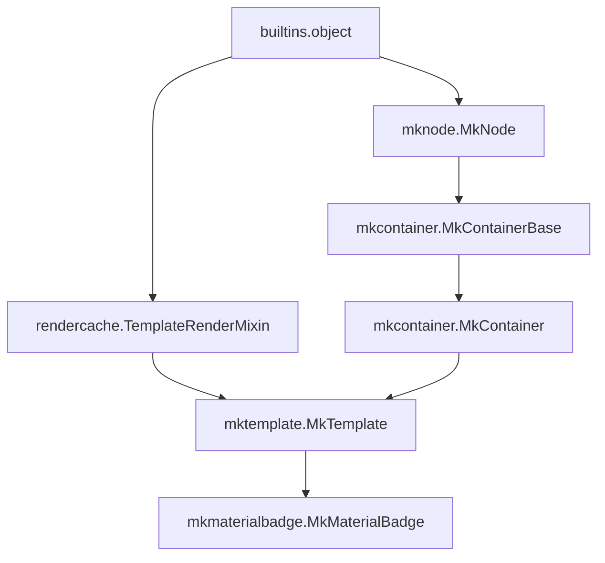

# MkMaterialBadge

[ Show source on GitHub](https://github.com/phil65/mknodes/blob/main/src/mknodes/basenodes/mkmaterialbadge/__init__.py)

### Node for a CSS-based badge a la MkDocs-Material.

<details open>
<summary>Examples</summary>

### Example: **Regular**
> [!NOTE]
> **Jinja**
>
> ```jinja
> {{ "mdi:wrench" | MkMaterialBadge(text="text") }}
>
> ```

> [!NOTE]
> **Python**
>
> ```python
> MkMaterialBadge('mdi:wrench', 'text')
> ```

<details open>
<summary>Rendered</summary>

 <code>text</code>

</details>

<details>
<summary>Markdown</summary>

```markdown
 <code>text</code>
```

</details>

<details>
<summary>Html</summary>

```html
<p> <code>text</code></p>

```

</details>

<details>
<summary>GitHub</summary>

```markdown
 <code>text</code>
```

</details>

### Example: **Heart type**
> [!NOTE]
> **Jinja**
>
> ```jinja
> {{ "mdi:file" | MkMaterialBadge(text="text", animated=True) }}
>
> ```

> [!NOTE]
> **Python**
>
> ```python
> MkMaterialBadge('mdi:file', 'text', animated=True)
> ```

<details open>
<summary>Rendered</summary>

 <code>text</code>

</details>

<details>
<summary>Markdown</summary>

```markdown
 <code>text</code>
```

</details>

<details>
<summary>Html</summary>

```html
<p> <code>text</code></p>

```

</details>

<details>
<summary>GitHub</summary>

```markdown
 <code>text</code>
```

</details>

### Example: **Right aligned**
> [!NOTE]
> **Jinja**
>
> ```jinja
> {{ "mdi:file" | MkMaterialBadge(text="text", align_right=True) }}
>
> ```

> [!NOTE]
> **Python**
>
> ```python
> MkMaterialBadge('mdi:file', 'text', align_right=True)
> ```

<details open>
<summary>Rendered</summary>

 <code>text</code>

</details>

<details>
<summary>Markdown</summary>

```markdown
 <code>text</code>
```

</details>

<details>
<summary>Html</summary>

```html
<p> <code>text</code></p>

```

</details>

<details>
<summary>GitHub</summary>

```markdown
 <code>text</code>
```

</details>

### Example: **With link**
> [!NOTE]
> **Jinja**
>
> ```jinja
> {{ "mdi:file" | MkMaterialBadge(text="text", target="https://phil65.github.io/mknodes") }}
>
> ```

> [!NOTE]
> **Python**
>
> ```python
> MkMaterialBadge('mdi:file', 'text', target='https://phil65.github.io/mknodes')
> ```

<details open>
<summary>Rendered</summary>

[ <code>text</code>](https://phil65.github.io/mknodes)

</details>

<details>
<summary>Markdown</summary>

```markdown
[ <code>text</code>](https://phil65.github.io/mknodes)
```

</details>

<details>
<summary>Html</summary>

```html
<p><a href="https://phil65.github.io/mknodes"> <code>text</code></a></p>

```

</details>

<details>
<summary>GitHub</summary>

```markdown
[ <code>text</code>](https://phil65.github.io/mknodes)
```

</details>

</details>

<details open>
<summary>DocStrings</summary>

<a id="mknodes.MkMaterialBadge"></a>

```python
class MkMaterialBadge(mktemplate.MkTemplate)
```

</details>

<details open>
<summary>Base classes</summary>

| Name | Children | Inherits |
|--- | --- | --- |
| **<font size='4'>[MkTemplate](https://phil65.github.io/mknodes/)</font>**<br>*<font size='1'>mknodes.templatenodes.mktemplate</font>*<br>Node representing a jinja template\. | <ul><li>[MkCliDoc](https://phil65.github.io/mknodes/)</li><li>[MkMaterialBadge](https://phil65.github.io/mknodes/)</li><li>[MkImageCompare](https://phil65.github.io/mknodes/)</li><li>[MkImageSlideshow](https://phil65.github.io/mknodes/)</li><li>[MkIFrame](https://phil65.github.io/mknodes/)</li><li>[MkCard](https://phil65.github.io/mknodes/)</li><li>[MkInstallGuide](https://phil65.github.io/mknodes/)</li><li>[MkCodeOfConduct](https://phil65.github.io/mknodes/)</li><li>[MkCommitConventions](https://phil65.github.io/mknodes/)</li><li>[MkDevEnvSetup](https://phil65.github.io/mknodes/)</li><li>[MkDevTools](https://phil65.github.io/mknodes/)</li><li>...</li></ul> | <ul><li>[TemplateRenderMixin](https://phil65.github.io/mknodes/)</li><li>[MkContainer](https://phil65.github.io/mknodes/)</li></ul> |

</details>

<details>
<summary>⋔ Inheritance diagram</summary>



</details>

<details>
<summary>NodeFile</summary>

**/home/runner/work/mknodes/mknodes/src/mknodes/basenodes/mkmaterialbadge/metadata.toml**

```toml
[metadata]
name = "MkMaterialBadge"
icon = "simple-icons:shieldsdotio"
group = "badge"

[[resources.css]]
filename = "materialbadge.css"

[examples.regular]
title = "Regular"
jinja = """
{{ "mdi:wrench" | MkMaterialBadge(text="text") }}
"""

[examples.heart_type]
title = "Heart type"
jinja = """
{{ "mdi:file" | MkMaterialBadge(text="text", animated=True) }}
"""

[examples.right_aligned]
title = "Right aligned"
jinja = """
{{ "mdi:file" | MkMaterialBadge(text="text", align_right=True) }}
"""

[examples.linked]
title = "With link"
jinja = """
{{ "mdi:file" | MkMaterialBadge(text="text", target="https://phil65.github.io/mknodes") }}
"""

[output.html]
template = """
<span class="md-typeset mdx-badge{{ " mdx-badge--right" if node.align_right else "" }}{{ " mdx-badge--heart" if node.animated else "" }}">

  <span class="mdx-badge__icon">{{ icon }}</span>

  <span class="mdx-badge__text">{{ node.get_text() }}</span>

</span>
"""

```

</details>

<details>
<summary>Code</summary>

**mknodes.basenodes.mkmaterialbadge.MkMaterialBadge**

```python
class MkMaterialBadge(mktemplate.MkTemplate):
    """Node for a CSS-based badge a la MkDocs-Material."""

    ICON = "simple/shieldsdotio"
    CSS = [resources.CSSFile("materialbadge.css")]

    def __init__(
        self,
        icon: str,
        text: str = "",
        *,
        animated: bool = False,
        align_right: bool = False,
        target: linkprovider.LinkableType | None = None,
        **kwargs: Any,
    ) -> None:
        """Constructor.

        Args:
            icon: Icon to display. Can either be an iconify or an emoji slug
            text: Text to display
            animated: Optional animated style
            align_right: Right-align badge
            target: An optional URL / page target for the badge
            kwargs: Keyword arguments passed to parent
        """
        super().__init__("output/html/template", **kwargs)
        self.icon = icon
        self._text = text
        self.animated = animated
        self.align_right = align_right
        self.target = target

    def get_text(self) -> str:
        return self._text

```

</details>

<details>
<summary>Page info</summary>

<details>
<summary>Code for this page</summary>

**mknodes.manual.nodes_section.create_section_for_nodes**

```python
def create_section_for_nodes(
    nav: mk.MkNav,
    klasses: Sequence[type[mk.MkNode]],
) -> mk.MkTable:
    table = mk.MkTable(columns=["Node", "Docstrings", "Markdown extensions"])
    for kls in klasses:
        tpl = "classpage_custom.jinja"
        page = mk.MkClassPage(kls, icon=kls.ICON, template_path=tpl, parent=nav, hide="toc")
        nav += page
        if kls.STATUS:
            page.metadata.status = kls.STATUS
        elif kls.JS_FILES:
            page.metadata.status = "js"
        elif kls.CSS:
            page.metadata.status = "css"
        page.created_by = create_section_for_nodes
        link = mk.MkLink(page, kls.__name__, icon=kls.ICON)
        extensions = ", ".join(f"`{i}`" for i in kls.REQUIRED_EXTENSIONS)
        table.add_row((link, kls.__doc__, extensions))
    return table

```

</details>

<details>
<summary>Resources</summary>

```python
Resources(css=[],
          markdown_extensions={'admonition': {},
                               'pymdownx.details': {},
                               'pymdownx.highlight': {'anchor_linenums': True,
                                                      'line_spans': '__span',
                                                      'pygments_lang_class': True},
                               'pymdownx.superfences': {'custom_fences': [{'class': 'mermaid',
                                                                           'format': <function fence_code_format at 0x7bb797a5c1a0>,
                                                                           'name': 'mermaid'}]},
                               'pymdownx.tabbed': {},
                               'tables': {}},
          plugins=[Plugin('mkdocstrings')],
          js=[],
          assets=[],
          packages=[])
```

</details>

<details>
<summary>Metadata</summary>

```yaml
created:
  source_filename: /home/runner/work/mknodes/mknodes/src/mknodes/manual/nodes_section.py
  source_function: create_section_for_nodes
  source_line_no: 93
hide:
- toc
icon: simple/shieldsdotio
status: new
title: MkMaterialBadge

```

</details>

</details>
