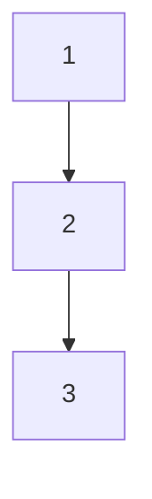
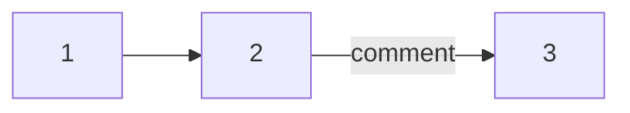
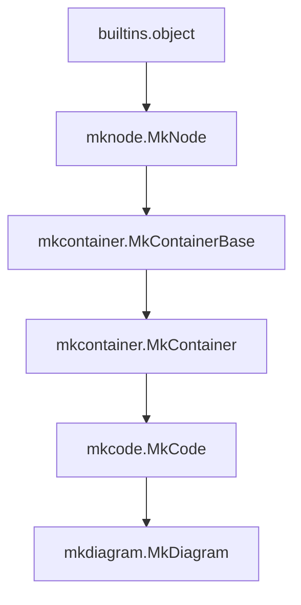

# MkDiagram

[ Show source on GitHub](https://github.com/phil65/mknodes/blob/main/src/mknodes/basenodes/mkdiagram/__init__.py)

### Class representing a mermaid diagram.

> [!NOTE]
> **Description**
>
>
> MkDiagrams can show directed acyclic graphs and allows to manually
> create diagrams.

<details open>
<summary>Examples</summary>

### Example: **Regular**
> [!NOTE]
> **Jinja**
>
> ```jinja
> {{ ["1", "2", "3"] | MkDiagram(connections=[("1", "2"), ("2", "3")]) }}
>
> ```

> [!NOTE]
> **Python**
>
> ```python
> MkDiagram(['1', '2', '3'], {('1', '2'), ('2', '3')})
> ```

<details open>
<summary>Rendered</summary>



</details>

<details>
<summary>Markdown</summary>

`````markdown
````mermaid
graph TD
  1
  2
  3
  1 --> 2
  2 --> 3
````
`````

</details>

<details>
<summary>Html</summary>

```html
<pre><code class="language-mermaid">graph TD
  1
  2
  3
  1 --&gt; 2
  2 --&gt; 3
</code></pre>

```

</details>

<details>
<summary>GitHub</summary>

`````markdown
````mermaid
graph TD
  1
  2
  3
  1 --> 2
  2 --> 3
````
`````

</details>

### Example: **Direction**
> [!NOTE]
> **Jinja**
>
> ```jinja
> {{ ["1", "2", "3"] | MkDiagram(connections=[("1", "2"), ("2", "3", "comment")], direction="LR") }}
>
> ```

> [!NOTE]
> **Python**
>
> ```python
> MkDiagram(['1', '2', '3'], {('1', '2'), ('2', '3', 'comment')}, direction='LR')
> ```

<details open>
<summary>Rendered</summary>



</details>

<details>
<summary>Markdown</summary>

`````markdown
````mermaid
graph LR
  1
  2
  3
  1 --> 2
  2 --> |comment| 3
````
`````

</details>

<details>
<summary>Html</summary>

```html
<pre><code class="language-mermaid">graph LR
  1
  2
  3
  1 --&gt; 2
  2 --&gt; |comment| 3
</code></pre>

```

</details>

<details>
<summary>GitHub</summary>

`````markdown
````mermaid
graph LR
  1
  2
  3
  1 --> 2
  2 --> |comment| 3
````
`````

</details>

</details>

<details open>
<summary>DocStrings</summary>

<a id="mknodes.MkDiagram"></a>

```python
class MkDiagram(mkcode.MkCode)
```

</details>

<details open>
<summary>Sub classes</summary>

| Name | Children | Inherits |
|--- | --- | --- |
| **<font size='4'>[MkClassDiagram](https://phil65.github.io/mknodes/)</font>**<br>*<font size='1'>mknodes.templatenodes.mkclassdiagram</font>*<br>Node to display the class hierarchy of a class\. Supports multiple modes\. | <ul></ul> | <ul><li>[MkDiagram](https://phil65.github.io/mknodes/)</li></ul> |
| **<font size='4'>[MkPipDepTree](https://phil65.github.io/mknodes/)</font>**<br>*<font size='1'>mknodes.templatenodes.mkpipdeptree</font>*<br>Node to display a mermaid diagram for the dependencies\. | <ul></ul> | <ul><li>[MkDiagram](https://phil65.github.io/mknodes/)</li></ul> |

</details>

<details open>
<summary>Base classes</summary>

| Name | Children | Inherits |
|--- | --- | --- |
| **<font size='4'>[MkCode](https://phil65.github.io/mknodes/)</font>**<br>*<font size='1'>mknodes.basenodes.mkcode</font>*<br>Class representing a Code block\. | <ul><li>[MkDiagram](https://phil65.github.io/mknodes/)</li><li>[MkTreeView](https://phil65.github.io/mknodes/)</li></ul> | <ul><li>[MkContainer](https://phil65.github.io/mknodes/)</li></ul> |

</details>

<details>
<summary>⋔ Inheritance diagram</summary>



</details>

<details>
<summary>NodeFile</summary>

**/home/runner/work/mknodes/mknodes/src/mknodes/basenodes/mkdiagram/metadata.toml**

```toml
[metadata]
icon = "mdi:graph-outline"
name = "MkDiagram"
group = "diagram"

[[requirements.extension."pymdownx.superfences".custom_fences]]
name = "mermaid"
class = "mermaid"
format = "pymdownx.superfences.fence_code_format"

[examples.regular]
title = "Regular"
jinja = """
{{ ["1", "2", "3"] | MkDiagram(connections=[("1", "2"), ("2", "3")]) }}
"""

[examples.direction]
title = "Direction"
jinja = """
{{ ["1", "2", "3"] | MkDiagram(connections=[("1", "2"), ("2", "3", "comment")], direction="LR") }}
"""

[output.markdown]
template = """
{{ node.fence_boundary }} mermaid
graph {{ node.direction }}


  {{ name }}



  {{ connection[0] }} --> {{ connection[1] }}

  {{ connection[0] }} --> |{{ connection[2] }}| {{ connection[1] }}




  {{ name | get_hash }}["{{ name }}"]


  {{ prev | get_hash }} --> {{ nxt | get_hash }}


{{ node.fence_boundary }}
"""

```

</details>

<details>
<summary>Code</summary>

**mknodes.basenodes.mkdiagram.MkDiagram**

```python
class MkDiagram(mkcode.MkCode):
    """Class representing a mermaid diagram.

    MkDiagrams can show directed acyclic graphs and allows to manually
    create diagrams.
    """

    ICON = "material/graph-outline"
    REQUIRED_EXTENSIONS = [resources.Extension("pymdownx.superfences", **config)]

    def __init__(
        self,
        names: list[str] | None = None,
        connections: list[tuple[str, str] | tuple[str, str, str]] | None = None,
        *,
        direction: Literal["TD", "DT", "LR", "RL"] = "TD",
        **kwargs: Any,
    ) -> None:
        """Constructor.

        Args:
            names: names which should be part of the diagram
            connections: tuples indicating the connections of the names
            direction: diagram direction
            kwargs: Keyword arguments passed to parent
        """
        super().__init__(language="mermaid", **kwargs)
        self.direction = direction
        # Preserve order. Useful if only names are passed, order is important then.
        self.names = iterfilters.reduce_list(names or [])
        self.connections = set(connections or [])

    def get_text(self) -> str:
        """MkCode override."""
        return f"graph {self.direction}\n{self.get_mermaid_code()}"

    def get_mermaid_code(self) -> str:
        """Return code block, excluding fences and (graph type direction) line.

        Can be overriden by subclasses.
        """
        lines = list(self.names)
        if not self.connections:
            lines = [f'{utils.get_hash(i)}["{i}"]' for i in lines]
            for prev, nxt in itertools.pairwise(self.names):
                lines.append(f"{utils.get_hash(prev)} --> {utils.get_hash(nxt)}")
            return textwrap.indent("\n".join(lines), "  ")
        for connection in self.connections:
            if len(connection) == 2:  # noqa: PLR2004
                source, target = connection
                lines.append(f"{source} --> {target}")
            elif len(connection) == 3:  # noqa: PLR2004
                source, target, mark = connection
                lines.append(f"{source} --> |{mark}| {target}")
            else:
                msg = f"Tuple with wrong length: {connection}"
                raise TypeError(msg)
        return textwrap.indent("\n".join(lines), "  ")

    @property
    def fence_title(self) -> str:
        """MkCode override."""
        return "mermaid"

```

</details>

<details>
<summary>Page info</summary>

<details>
<summary>Code for this page</summary>

**mknodes.manual.nodes_section.create_section_for_nodes**

```python
def create_section_for_nodes(
    nav: mk.MkNav,
    klasses: Sequence[type[mk.MkNode]],
) -> mk.MkTable:
    table = mk.MkTable(columns=["Node", "Docstrings", "Markdown extensions"])
    for kls in klasses:
        tpl = "classpage_custom.jinja"
        page = mk.MkClassPage(kls, icon=kls.ICON, template_path=tpl, parent=nav, hide="toc")
        nav += page
        if kls.STATUS:
            page.metadata.status = kls.STATUS
        elif kls.JS_FILES:
            page.metadata.status = "js"
        elif kls.CSS:
            page.metadata.status = "css"
        page.created_by = create_section_for_nodes
        link = mk.MkLink(page, kls.__name__, icon=kls.ICON)
        extensions = ", ".join(f"`{i}`" for i in kls.REQUIRED_EXTENSIONS)
        table.add_row((link, kls.__doc__, extensions))
    return table

```

</details>

<details>
<summary>Resources</summary>

```python
Resources(css=[],
          markdown_extensions={'admonition': {},
                               'pymdownx.details': {},
                               'pymdownx.highlight': {'anchor_linenums': True,
                                                      'line_spans': '__span',
                                                      'pygments_lang_class': True},
                               'pymdownx.superfences': {'custom_fences': [{'class': 'mermaid',
                                                                           'format': <function fence_code_format at 0x7bb797a5c1a0>,
                                                                           'name': 'mermaid'}]},
                               'pymdownx.tabbed': {},
                               'tables': {}},
          plugins=[Plugin('mkdocstrings')],
          js=[],
          assets=[],
          packages=[])
```

</details>

<details>
<summary>Metadata</summary>

```yaml
created:
  source_filename: /home/runner/work/mknodes/mknodes/src/mknodes/manual/nodes_section.py
  source_function: create_section_for_nodes
  source_line_no: 93
hide:
- toc
icon: material/graph-outline
title: MkDiagram

```

</details>

</details>
