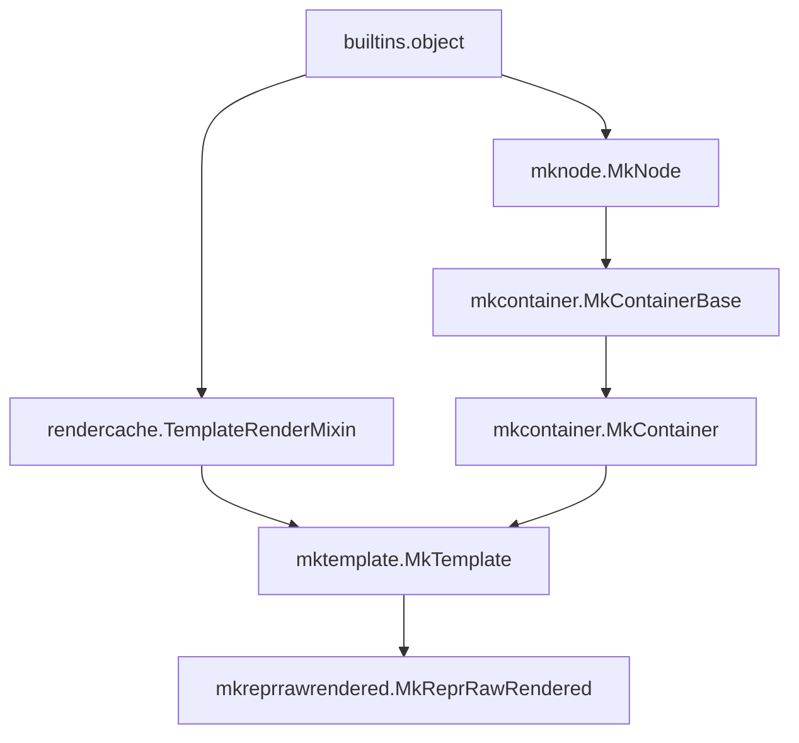

# MkReprRawRendered

[ Show source on GitHub](https://github.com/phil65/mknodes/blob/main/src/mknodes/templatenodes/mkreprrawrendered/__init__.py)

### Node showing a tabbed block to visualize a node in different representations.

> [!NOTE]
> **Description**
>
>
> It contains a tab for the repr, one for the rendered output,
> one for the markdown and a Repr tree in case the node has children.
> The node can also be a string with a jinja macro returning an MkNode.
> In that case a "Jinja" tab containing the macro is prepended to the other tabs.

<details open>
<summary>Examples</summary>

### Example: **Regular**
> [!NOTE]
> **Jinja**
>
> ```jinja
> {{ "Some text" | MkAdmonition | MkReprRawRendered }}
>
> ```

> [!NOTE]
> **Python**
>
> ```python
> MkContainer()
> ```

<details open>
<summary>Rendered</summary>

> [!NOTE]
> Some text

<details>
<summary>Repr</summary>

````python
MkAdmonition(None)
````

</details>

<details>
<summary>Raw</summary>

````markdown
> [!NOTE]
> Some text

````

</details>

<details>
<summary>Html</summary>

````html
<div class="markdown-alert markdown-alert-note">
<p class="markdown-alert-title">Note</p>
<p>Some text</p>
</div>

````

</details>

<details open>
<summary>Rendered</summary>

> [!NOTE]
> Some text

</details>

<details>
<summary>Repr tree</summary>

````
MkAdmonition
╰── MkText('Some text')
````

</details>

</details>

<details>
<summary>Markdown</summary>

`````markdown
> [!NOTE]
> Some text

<details>
<summary>Repr</summary>

````python
MkAdmonition(None)
````

</details>

<details>
<summary>Raw</summary>

````markdown
> [!NOTE]
> Some text

````

</details>

<details>
<summary>Html</summary>

````html
<div class="markdown-alert markdown-alert-note">
<p class="markdown-alert-title">Note</p>
<p>Some text</p>
</div>

````

</details>

<details open>
<summary>Rendered</summary>

> [!NOTE]
> Some text

</details>

<details>
<summary>Repr tree</summary>

````
MkAdmonition
╰── MkText('Some text')
````

</details>

`````

</details>

<details>
<summary>Html</summary>

```html
<div class="markdown-alert markdown-alert-note">
<p class="markdown-alert-title">Note</p>
<p>Some text</p>
</div>
<details>
<summary>Repr</summary>
<pre><code class="language-python">MkAdmonition(None)
</code></pre>
</details>
<details>
<summary>Raw</summary>
<pre><code class="language-markdown">&gt; [!NOTE]
&gt; Some text

</code></pre>
</details>
<details>
<summary>Html</summary>
<pre><code class="language-html">&lt;div class=&quot;markdown-alert markdown-alert-note&quot;&gt;
&lt;p class=&quot;markdown-alert-title&quot;&gt;Note&lt;/p&gt;
&lt;p&gt;Some text&lt;/p&gt;
&lt;/div&gt;

</code></pre>
</details>
<details open>
<summary>Rendered</summary>
<div class="markdown-alert markdown-alert-note">
<p class="markdown-alert-title">Note</p>
<p>Some text</p>
</div>
</details>
<details>
<summary>Repr tree</summary>
<pre><code>MkAdmonition
╰── MkText('Some text')
</code></pre>
</details>

```

</details>

<details>
<summary>Repr tree</summary>

```
MkContainer
        ╰── MkAdmonition(None)
            ╰── MkText('Some text')
╰── MkReprRawRendered(MkAdmonition(None))
    ├── MkTab(title='Repr', content=MkCode(None), new=True)
    │   ╰── MkCode(None)
    │       ╰── MkText('MkAdmonition(None)')
    ├── MkTab(title='Raw', content=MkCode(None, language='markdown'))
    │   ╰── MkCode(None, language='markdown')
    │   ╰── MkAdmonition(None)
    │       ╰── MkText('Some text')
    ├── MkTab(title='Html', content=MkCode(None, language='html'))
    │   ╰── MkCode(None, language='html')
    │       ╰── MkText('<div class="markdown-alert markdown-alert-note">\n<p class="markdown-alert-title">Note</p>\n<p>Some text</p>\n</div>\n')
    ├── MkTab(title='Rendered', content=MkAdmonition(None), select=True)
    │   ╰── MkAdmonition(None)
    │       ╰── MkText('Some text')
    ╰── MkTab(title='Repr tree', content=MkTreeView(MkAdmonition(None)))
        ╰── MkTreeView(MkAdmonition(None))
```

</details>

</details>

<details open>
<summary>DocStrings</summary>

<a id="mknodes.MkReprRawRendered"></a>

```python
class MkReprRawRendered(mktemplate.MkTemplate)
```

</details>

<details open>
<summary>Base classes</summary>

| Name | Children | Inherits |
|--- | --- | --- |
| **<font size='4'>[MkTemplate](https://phil65.github.io/mknodes/)</font>**<br>*<font size='1'>mknodes.templatenodes.mktemplate</font>*<br>Node representing a jinja template\. | <ul><li>[MkCliDoc](https://phil65.github.io/mknodes/)</li><li>[MkMaterialBadge](https://phil65.github.io/mknodes/)</li><li>[MkImageCompare](https://phil65.github.io/mknodes/)</li><li>[MkImageSlideshow](https://phil65.github.io/mknodes/)</li><li>[MkIFrame](https://phil65.github.io/mknodes/)</li><li>[MkCard](https://phil65.github.io/mknodes/)</li><li>[MkInstallGuide](https://phil65.github.io/mknodes/)</li><li>[MkCodeOfConduct](https://phil65.github.io/mknodes/)</li><li>[MkCommitConventions](https://phil65.github.io/mknodes/)</li><li>[MkDevEnvSetup](https://phil65.github.io/mknodes/)</li><li>[MkDevTools](https://phil65.github.io/mknodes/)</li><li>...</li></ul> | <ul><li>[TemplateRenderMixin](https://phil65.github.io/mknodes/)</li><li>[MkContainer](https://phil65.github.io/mknodes/)</li></ul> |

</details>

<details>
<summary>⋔ Inheritance diagram</summary>



</details>

<details>
<summary>NodeFile</summary>

**/home/runner/work/mknodes/mknodes/src/mknodes/templatenodes/mkreprrawrendered/metadata.toml**

```toml
[metadata]
icon = "mdi:presentation"
name = "MkReprRawRendered"
group = "documentation"
virtual_children = true

[examples.regular]
title = "Regular"
jinja = """
{{ "Some text" | MkAdmonition | MkReprRawRendered }}
"""

[output.markdown]
template = """



{{ node | getattr("_node") | MkTab(title="Jinja") }}

{{ inspected | repr | MkCode | MkTab(title="Repr", new=True) }}
{{ inspected | MkCode(language="markdown") | MkTab(title="Raw") }}
{{ inspected | to_html | MkCode(language="html") | MkTab(title="Html") }}
{{ inspected | MkTab(title="Rendered", select=True) }}

{{ inspected | MkTreeView | MkTab(title="Repr tree") }}
"""

```

</details>

<details>
<summary>Code</summary>

**mknodes.templatenodes.mkreprrawrendered.MkReprRawRendered**

```python
class MkReprRawRendered(mktemplate.MkTemplate):
    """Node showing a tabbed block to visualize a node in different representations.

    It contains a tab for the repr, one for the rendered output,
    one for the markdown and a Repr tree in case the node has children.
    The node can also be a string with a jinja macro returning an MkNode.
    In that case a "Jinja" tab containing the macro is prepended to the other tabs.
    """

    ICON = "material/presentation"

    def __init__(self, node: mknode.MkNode | str | None = None, **kwargs: Any) -> None:
        """Constructor.

        Args:
            node: Node to show an example for
            kwargs: Keyword arguments passed to parent
        """
        self._node = node
        super().__init__("output/markdown/template", **kwargs)

    def get_mknode(self) -> mk.MkNode | None:
        match self._node:
            case None:
                return None
            case str():
                return self.env.render_nodes(string=self._node).children[0]
            case _:
                return self._node

```

</details>

<details>
<summary>Page info</summary>

<details>
<summary>Code for this page</summary>

**mknodes.manual.nodes_section.create_section_for_nodes**

```python
def create_section_for_nodes(
    nav: mk.MkNav,
    klasses: Sequence[type[mk.MkNode]],
) -> mk.MkTable:
    table = mk.MkTable(columns=["Node", "Docstrings", "Markdown extensions"])
    for kls in klasses:
        tpl = "classpage_custom.jinja"
        page = mk.MkClassPage(kls, icon=kls.ICON, template_path=tpl, parent=nav, hide="toc")
        nav += page
        if kls.STATUS:
            page.metadata.status = kls.STATUS
        elif kls.JS_FILES:
            page.metadata.status = "js"
        elif kls.CSS:
            page.metadata.status = "css"
        page.created_by = create_section_for_nodes
        link = mk.MkLink(page, kls.__name__, icon=kls.ICON)
        extensions = ", ".join(f"`{i}`" for i in kls.REQUIRED_EXTENSIONS)
        table.add_row((link, kls.__doc__, extensions))
    return table

```

</details>

<details>
<summary>Resources</summary>

```python
Resources(css=[],
          markdown_extensions={'admonition': {},
                               'pymdownx.details': {},
                               'pymdownx.highlight': {'anchor_linenums': True,
                                                      'line_spans': '__span',
                                                      'pygments_lang_class': True},
                               'pymdownx.superfences': {'custom_fences': [{'class': 'mermaid',
                                                                           'format': <function fence_code_format at 0x7bb797a5c1a0>,
                                                                           'name': 'mermaid'}]},
                               'pymdownx.tabbed': {},
                               'tables': {}},
          plugins=[Plugin('mkdocstrings')],
          js=[],
          assets=[],
          packages=[])
```

</details>

<details>
<summary>Metadata</summary>

```yaml
created:
  source_filename: /home/runner/work/mknodes/mknodes/src/mknodes/manual/nodes_section.py
  source_function: create_section_for_nodes
  source_line_no: 93
hide:
- toc
icon: material/presentation
status: new
title: MkReprRawRendered

```

</details>

</details>
