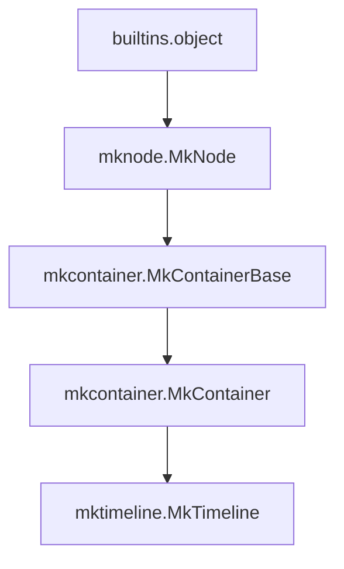

# MkTimeline

[ Show source on GitHub](https://github.com/phil65/mknodes/blob/main/src/mknodes/basenodes/mktimeline/__init__.py)

### Node to show a JavaScript-supported Timeline.

> [!NOTE]
> **Description**
>
>
> Consists of cards which slide in and out once they enter / leave the screen.

<details open>
<summary>Examples</summary>

### Example: **From TOML format**
> [!NOTE]
> **Jinja**
>
> ```jinja
> {{
> "
> ['Step 1']
> title = 'test'
> content = 'Some **markdown**'
> image = 'https://picsum.photos/400'
> ['Step 2']
> title = 'test'
> content = 'Some **markdown**'
> image = 'https://picsum.photos/401'
>
> " | load_toml | MkTimeline
> }}
>
> ```

> [!NOTE]
> **Python**
>
> ```python
> MkTimeline([...])
> ```

<details open>
<summary>Rendered</summary>

<section class="timeline">
<div class="timeline-item">
<div class="timeline-img"></div>
<div class="timeline-content timeline-card js--fadeInLeft">
<div style="background: linear-gradient(rgba(0, 0, 0, 0), rgba(0, 0, 0, 0.4)), url(https://picsum.photos/400) center center no-repeat; background-size: cover;" class="timeline-img-header">
<p>
<h2>test</h2>
</p>
</div>
<p>
<p>Some <strong>markdown</strong>
</p>
</p>
</div>
</div>
<div class="timeline-item">
<div class="timeline-img"></div>
<div class="timeline-content timeline-card js--fadeInRight">
<div style="background: linear-gradient(rgba(0, 0, 0, 0), rgba(0, 0, 0, 0.4)), url(https://picsum.photos/401) center center no-repeat; background-size: cover;" class="timeline-img-header">
<p>
<h2>test</h2>
</p>
</div>
<p>
<p>Some <strong>markdown</strong>
</p>
</p>
</div>
</div>
</section>

</details>

<details>
<summary>Markdown</summary>

```markdown

<section class="timeline">
<div class="timeline-item">
<div class="timeline-img"></div>
<div class="timeline-content timeline-card js--fadeInLeft">
<div style="background: linear-gradient(rgba(0, 0, 0, 0), rgba(0, 0, 0, 0.4)), url(https://picsum.photos/400) center center no-repeat; background-size: cover;" class="timeline-img-header">
<p>
<h2>test</h2>
</p>
</div>
<p>
<p>Some <strong>markdown</strong>
</p>
</p>
</div>
</div>
<div class="timeline-item">
<div class="timeline-img"></div>
<div class="timeline-content timeline-card js--fadeInRight">
<div style="background: linear-gradient(rgba(0, 0, 0, 0), rgba(0, 0, 0, 0.4)), url(https://picsum.photos/401) center center no-repeat; background-size: cover;" class="timeline-img-header">
<p>
<h2>test</h2>
</p>
</div>
<p>
<p>Some <strong>markdown</strong>
</p>
</p>
</div>
</div>
</section>

```

</details>

<details>
<summary>Html</summary>

```html
<section class="timeline">
<div class="timeline-item">
<div class="timeline-img"></div>
<div class="timeline-content timeline-card js--fadeInLeft">
<div style="background: linear-gradient(rgba(0, 0, 0, 0), rgba(0, 0, 0, 0.4)), url(https://picsum.photos/400) center center no-repeat; background-size: cover;" class="timeline-img-header">
<p>
<h2>test</h2>
</p>
</div>
<p>
<p>Some <strong>markdown</strong>
</p>
</p>
</div>
</div>
<div class="timeline-item">
<div class="timeline-img"></div>
<div class="timeline-content timeline-card js--fadeInRight">
<div style="background: linear-gradient(rgba(0, 0, 0, 0), rgba(0, 0, 0, 0.4)), url(https://picsum.photos/401) center center no-repeat; background-size: cover;" class="timeline-img-header">
<p>
<h2>test</h2>
</p>
</div>
<p>
<p>Some <strong>markdown</strong>
</p>
</p>
</div>
</div>
</section>

```

</details>

<details>
<summary>Repr tree</summary>

```
MkTimeline
├── MkTimelineItem('test', None, image='https://picsum.photos/400')
│   ╰── MkText('Some **markdown**')
╰── MkTimelineItem('test', None, image='https://picsum.photos/401')
    ╰── MkText('Some **markdown**')
```

</details>

</details>

<details open>
<summary>DocStrings</summary>

<a id="mknodes.MkTimeline"></a>

```python
class MkTimeline(mkcontainer.MkContainer)
```

</details>

<details open>
<summary>Base classes</summary>

| Name | Children | Inherits |
|--- | --- | --- |
| **<font size='4'>[MkContainer](https://phil65.github.io/mknodes/)</font>**<br>*<font size='1'>mknodes.basenodes.mkcontainer</font>*<br>A node containing other MkNodes\. | <ul><li>[MkBlock](https://phil65.github.io/mknodes/)</li><li>[MkAdmonition](https://phil65.github.io/mknodes/)</li><li>[MkBlockQuote](https://phil65.github.io/mknodes/)</li><li>[MkCode](https://phil65.github.io/mknodes/)</li><li>[MkTemplate](https://phil65.github.io/mknodes/)</li><li>[MkList](https://phil65.github.io/mknodes/)</li><li>[MkBaseTable](https://phil65.github.io/mknodes/)</li><li>[MkTab](https://phil65.github.io/mknodes/)</li><li>[MkTabContainer](https://phil65.github.io/mknodes/)</li><li>[MkCritic](https://phil65.github.io/mknodes/)</li><li>[MkAnnotation](https://phil65.github.io/mknodes/)</li><li>...</li></ul> | <ul><li>[MkContainerBase](https://phil65.github.io/mknodes/)</li></ul> |

</details>

<details>
<summary>⋔ Inheritance diagram</summary>



</details>

<details>
<summary>NodeFile</summary>

**/home/runner/work/mknodes/mknodes/src/mknodes/basenodes/mktimeline/metadata.toml**

```toml
[metadata]
icon = "mdi:timeline"
name = "MkTimeline"

[[resources.css]]
filename = "timeline.css"

[[resources.js]]
is_library = true
link = "https://cdn.jsdelivr.net/npm/scrollreveal@3.4.0/dist/scrollreveal.min.js"

[[resources.js]]
link = "https://code.jquery.com/jquery-2.2.4.min.js"
is_library = true

[[resources.js]]
filename = "timeline.js"

[examples.toml]
title = "From TOML format"
jinja = """
{{
"
['Step 1']
title = 'test'
content = 'Some **markdown**'
image = 'https://picsum.photos/400'
['Step 2']
title = 'test'
content = 'Some **markdown**'
image = 'https://picsum.photos/401'

" | load_toml | MkTimeline
}}
"""

[fragments]
item = """
<div class="timeline-item">
<div class="timeline-img"></div>
<div class="timeline-content{{ " timeline-card" if node.image else "" }} js--fadeIn{{ node.fade_direction | capitalize }}">

<div style="background: linear-gradient(rgba(0, 0, 0, 0), rgba(0, 0, 0, 0.4)), url({{ node.image }}) center center no-repeat; background-size: cover;" class="timeline-img-header">
<p>
<h2>{{ node.title }}</h2>
</p>
</div>

<h2>{{ node.title }}</h2>


<div class="date">{{ node.label }}</div>

<p>
{{ node.content | to_html }}
</p>
{{ node.button_text | html_link(node.link, class_="bnt-more") }}
</div>
</div>
"""

# [output.markdown]
# template = """

# <section class="timeline">
# 
# {{ "fragments/item" | render_template(node=item) }}
# 
# </section>

# """

```

</details>

<details>
<summary>Code</summary>

**mknodes.basenodes.mktimeline.MkTimeline**

```python
class MkTimeline(mkcontainer.MkContainer):
    """Node to show a JavaScript-supported Timeline.

    Consists of cards which slide in and out once they enter / leave the screen.
    """

    ICON = "material/timeline"
    JS_FILES = [
        resources.JSFile(JQUERY_LINK, is_library=True),
        resources.JSFile(SCROLLREVEAL_LINK, is_library=True),
        resources.JSText(SCRIPT, "scrollreveal.js"),  # type: ignore[list-item]
        resources.JSFile("timeline.js"),
    ]
    CSS = [resources.CSSFile("timeline.css")]

    def __init__(
        self,
        items: list[Any] | str | dict[str, Any] | os.PathLike[str] | None = None,
        **kwargs: Any,
    ) -> None:
        """Constructor.

        Args:
            items: Timeline items or a path to a TOML file containing timeline data
            kwargs: Keyword arguments passed to parent
        """
        if isinstance(items, str | os.PathLike):
            text = pathhelpers.load_file_cached(str(items))
            data = tomllib.loads(text)
            items = [MkTimelineItem(**step) for step in data.values()]
        elif isinstance(items, dict):
            items = [MkTimelineItem(**step) for step in items.values()]
        super().__init__(items, **kwargs)

    def get_items(self) -> list[MkTimelineItem]:  # type: ignore[override]
        """Return the list of timeline items."""
        return self._items  # type: ignore[return-value]

    def get_element(self) -> xml.Section:
        root = xml.Section("timeline")
        for i, item in enumerate(self.get_items()):
            item.fade_direction = "left" if i % 2 == 0 else "right"
            elem = item.get_element()
            root.append(elem)
        return root

    def to_md_unprocessed(self) -> str:
        root = self.get_element()
        return "\n\n" + root.to_string(space="") + "\n\n"

    def add_item(
        self,
        title: str = "",
        content: str | mknode.MkNode = "",
        *,
        label: str = "",
        link: str = "",
        button_text: str = "More",
        image: str = "",
        **kwargs: Any,
    ):
        """Add a timeline item.

        title: Item header
        content: Markdown for content
        label: Label to be displayed in small box at the top
        link: Optional button-link. Text of button can be set via button_text
        button_text: Text for the link button.
        image: Optional image for the item
        kwargs: keyword arguments passed to parent
        """
        item = MkTimelineItem(
            title=title,
            content=content,
            label=label,
            link=link,
            button_text=button_text,
            image=image,
            **kwargs,
        )
        self += item
        return item

```

</details>

<details>
<summary>Page info</summary>

<details>
<summary>Code for this page</summary>

**mknodes.manual.nodes_section.create_section_for_nodes**

```python
def create_section_for_nodes(
    nav: mk.MkNav,
    klasses: Sequence[type[mk.MkNode]],
) -> mk.MkTable:
    table = mk.MkTable(columns=["Node", "Docstrings", "Markdown extensions"])
    for kls in klasses:
        tpl = "classpage_custom.jinja"
        page = mk.MkClassPage(kls, icon=kls.ICON, template_path=tpl, parent=nav, hide="toc")
        nav += page
        if kls.STATUS:
            page.metadata.status = kls.STATUS
        elif kls.JS_FILES:
            page.metadata.status = "js"
        elif kls.CSS:
            page.metadata.status = "css"
        page.created_by = create_section_for_nodes
        link = mk.MkLink(page, kls.__name__, icon=kls.ICON)
        extensions = ", ".join(f"`{i}`" for i in kls.REQUIRED_EXTENSIONS)
        table.add_row((link, kls.__doc__, extensions))
    return table

```

</details>

<details>
<summary>Resources</summary>

```python
Resources(css=[],
          markdown_extensions={'admonition': {},
                               'pymdownx.details': {},
                               'pymdownx.highlight': {'anchor_linenums': True,
                                                      'line_spans': '__span',
                                                      'pygments_lang_class': True},
                               'pymdownx.superfences': {'custom_fences': [{'class': 'mermaid',
                                                                           'format': <function fence_code_format at 0x7bb797a5c1a0>,
                                                                           'name': 'mermaid'}]},
                               'pymdownx.tabbed': {},
                               'tables': {}},
          plugins=[Plugin('mkdocstrings')],
          js=[],
          assets=[],
          packages=[])
```

</details>

<details>
<summary>Metadata</summary>

```yaml
created:
  source_filename: /home/runner/work/mknodes/mknodes/src/mknodes/manual/nodes_section.py
  source_function: create_section_for_nodes
  source_line_no: 93
hide:
- toc
icon: material/timeline
status: js
title: MkTimeline

```

</details>

</details>
