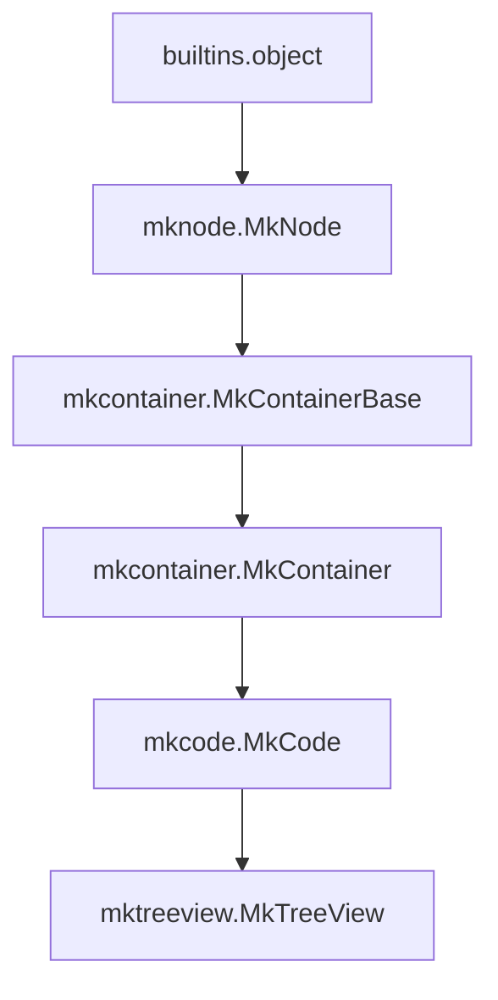

# MkTreeView

[ Show source on GitHub](https://github.com/phil65/mknodes/blob/main/src/mknodes/templatenodes/mktreeview/__init__.py)

### Node to display tree structures.

> [!NOTE]
> **Description**
>
>
> Currently supports directories and Node subclasses (including `MkNodes`).

<details open>
<summary>Examples</summary>

### Example: **Different styles**
> [!NOTE]
> **Jinja**
>
> ```jinja
> {{ "src/mknodes/manual" | MkTreeView }}
>
> ```

> [!NOTE]
> **Python**
>
> ```python
> MkTreeView('src/mknodes/manual')
> ```

<details open>
<summary>Rendered</summary>

```
📂 `manual`
┣━━ 📂 `__pycache__`
┃   ┣━━ 📄 `__init__.cpython-314.pyc (214 Bytes)`
┃   ┣━━ 📄 `a_quick_tour.cpython-314.pyc (2.0 kB)`
┃   ┣━━ 📄 `api_section.cpython-314.pyc (9.7 kB)`
┃   ┣━━ 📄 `dev_section.cpython-314.pyc (3.4 kB)`
┃   ┣━━ 📄 `flavors.cpython-314.pyc (13.8 kB)`
┃   ┣━━ 📄 `get_started_section.cpython-314.pyc (4.4 kB)`
┃   ┣━━ 📄 `navs_section.cpython-314.pyc (4.8 kB)`
┃   ┣━━ 📄 `nodes_section.cpython-314.pyc (10.5 kB)`
┃   ┣━━ 📄 `page_section.cpython-314.pyc (6.3 kB)`
┃   ┣━━ 📄 `root.cpython-314.pyc (3.6 kB)`
┃   ┣━━ 📄 `routing.cpython-314.pyc (2.6 kB)`
┃   ┗━━ 📄 `templating_section.cpython-314.pyc (4.3 kB)`
┣━━ 📂 `site`
┃   ┣━━ 📂 `__pycache__`
┃   ┃   ┣━━ 📄 `__init__.cpython-314.pyc (3.1 kB)`
┃   ┃   ┣━━ 📄 `cli_section.cpython-314.pyc (3.3 kB)`
┃   ┃   ┗━━ 📄 `use_cases_section.cpython-314.pyc (1.7 kB)`
┃   ┣━━ 🐍 `__init__.py (1.2 kB)`
┃   ┣━━ 🐍 `cli_section.py (932 Bytes)`
┃   ┗━━ 🐍 `use_cases_section.py (549 Bytes)`
┣━━ 🐍 `__init__.py (43 Bytes)`
┣━━ 🐍 `a_quick_tour.py (5.8 kB)`
┣━━ 🐍 `api_section.py (7.0 kB)`
┣━━ 🐍 `dev_section.py (840 Bytes)`
┣━━ 🐍 `flavors.py (7.8 kB)`
┣━━ 🐍 `get_started_section.py (1.8 kB)`
┣━━ 🐍 `github_index.py (608 Bytes)`
┣━━ 🐍 `navs_section.py (2.2 kB)`
┣━━ 🐍 `nodes_section.py (4.5 kB)`
┣━━ 🐍 `page_section.py (2.4 kB)`
┣━━ 🐍 `root.py (1.4 kB)`
┣━━ 🐍 `routing.py (1.1 kB)`
┣━━ 🐍 `standalone.py (1.4 kB)`
┗━━ 🐍 `templating_section.py (1.7 kB)`
```

</details>

<details>
<summary>Markdown</summary>

`````markdown
````
📂 `manual`
┣━━ 📂 `__pycache__`
┃   ┣━━ 📄 `__init__.cpython-314.pyc (214 Bytes)`
┃   ┣━━ 📄 `a_quick_tour.cpython-314.pyc (2.0 kB)`
┃   ┣━━ 📄 `api_section.cpython-314.pyc (9.7 kB)`
┃   ┣━━ 📄 `dev_section.cpython-314.pyc (3.4 kB)`
┃   ┣━━ 📄 `flavors.cpython-314.pyc (13.8 kB)`
┃   ┣━━ 📄 `get_started_section.cpython-314.pyc (4.4 kB)`
┃   ┣━━ 📄 `navs_section.cpython-314.pyc (4.8 kB)`
┃   ┣━━ 📄 `nodes_section.cpython-314.pyc (10.5 kB)`
┃   ┣━━ 📄 `page_section.cpython-314.pyc (6.3 kB)`
┃   ┣━━ 📄 `root.cpython-314.pyc (3.6 kB)`
┃   ┣━━ 📄 `routing.cpython-314.pyc (2.6 kB)`
┃   ┗━━ 📄 `templating_section.cpython-314.pyc (4.3 kB)`
┣━━ 📂 `site`
┃   ┣━━ 📂 `__pycache__`
┃   ┃   ┣━━ 📄 `__init__.cpython-314.pyc (3.1 kB)`
┃   ┃   ┣━━ 📄 `cli_section.cpython-314.pyc (3.3 kB)`
┃   ┃   ┗━━ 📄 `use_cases_section.cpython-314.pyc (1.7 kB)`
┃   ┣━━ 🐍 `__init__.py (1.2 kB)`
┃   ┣━━ 🐍 `cli_section.py (932 Bytes)`
┃   ┗━━ 🐍 `use_cases_section.py (549 Bytes)`
┣━━ 🐍 `__init__.py (43 Bytes)`
┣━━ 🐍 `a_quick_tour.py (5.8 kB)`
┣━━ 🐍 `api_section.py (7.0 kB)`
┣━━ 🐍 `dev_section.py (840 Bytes)`
┣━━ 🐍 `flavors.py (7.8 kB)`
┣━━ 🐍 `get_started_section.py (1.8 kB)`
┣━━ 🐍 `github_index.py (608 Bytes)`
┣━━ 🐍 `navs_section.py (2.2 kB)`
┣━━ 🐍 `nodes_section.py (4.5 kB)`
┣━━ 🐍 `page_section.py (2.4 kB)`
┣━━ 🐍 `root.py (1.4 kB)`
┣━━ 🐍 `routing.py (1.1 kB)`
┣━━ 🐍 `standalone.py (1.4 kB)`
┗━━ 🐍 `templating_section.py (1.7 kB)`
````
`````

</details>

<details>
<summary>Html</summary>

```html
<pre><code>📂 `manual`
┣━━ 📂 `__pycache__`
┃   ┣━━ 📄 `__init__.cpython-314.pyc (214 Bytes)`
┃   ┣━━ 📄 `a_quick_tour.cpython-314.pyc (2.0 kB)`
┃   ┣━━ 📄 `api_section.cpython-314.pyc (9.7 kB)`
┃   ┣━━ 📄 `dev_section.cpython-314.pyc (3.4 kB)`
┃   ┣━━ 📄 `flavors.cpython-314.pyc (13.8 kB)`
┃   ┣━━ 📄 `get_started_section.cpython-314.pyc (4.4 kB)`
┃   ┣━━ 📄 `navs_section.cpython-314.pyc (4.8 kB)`
┃   ┣━━ 📄 `nodes_section.cpython-314.pyc (10.5 kB)`
┃   ┣━━ 📄 `page_section.cpython-314.pyc (6.3 kB)`
┃   ┣━━ 📄 `root.cpython-314.pyc (3.6 kB)`
┃   ┣━━ 📄 `routing.cpython-314.pyc (2.6 kB)`
┃   ┗━━ 📄 `templating_section.cpython-314.pyc (4.3 kB)`
┣━━ 📂 `site`
┃   ┣━━ 📂 `__pycache__`
┃   ┃   ┣━━ 📄 `__init__.cpython-314.pyc (3.1 kB)`
┃   ┃   ┣━━ 📄 `cli_section.cpython-314.pyc (3.3 kB)`
┃   ┃   ┗━━ 📄 `use_cases_section.cpython-314.pyc (1.7 kB)`
┃   ┣━━ 🐍 `__init__.py (1.2 kB)`
┃   ┣━━ 🐍 `cli_section.py (932 Bytes)`
┃   ┗━━ 🐍 `use_cases_section.py (549 Bytes)`
┣━━ 🐍 `__init__.py (43 Bytes)`
┣━━ 🐍 `a_quick_tour.py (5.8 kB)`
┣━━ 🐍 `api_section.py (7.0 kB)`
┣━━ 🐍 `dev_section.py (840 Bytes)`
┣━━ 🐍 `flavors.py (7.8 kB)`
┣━━ 🐍 `get_started_section.py (1.8 kB)`
┣━━ 🐍 `github_index.py (608 Bytes)`
┣━━ 🐍 `navs_section.py (2.2 kB)`
┣━━ 🐍 `nodes_section.py (4.5 kB)`
┣━━ 🐍 `page_section.py (2.4 kB)`
┣━━ 🐍 `root.py (1.4 kB)`
┣━━ 🐍 `routing.py (1.1 kB)`
┣━━ 🐍 `standalone.py (1.4 kB)`
┗━━ 🐍 `templating_section.py (1.7 kB)`
</code></pre>

```

</details>

<details>
<summary>GitHub</summary>

`````markdown
````
📂 `manual`
┣━━ 📂 `__pycache__`
┃   ┣━━ 📄 `__init__.cpython-314.pyc (214 Bytes)`
┃   ┣━━ 📄 `a_quick_tour.cpython-314.pyc (2.0 kB)`
┃   ┣━━ 📄 `api_section.cpython-314.pyc (9.7 kB)`
┃   ┣━━ 📄 `dev_section.cpython-314.pyc (3.4 kB)`
┃   ┣━━ 📄 `flavors.cpython-314.pyc (13.8 kB)`
┃   ┣━━ 📄 `get_started_section.cpython-314.pyc (4.4 kB)`
┃   ┣━━ 📄 `navs_section.cpython-314.pyc (4.8 kB)`
┃   ┣━━ 📄 `nodes_section.cpython-314.pyc (10.5 kB)`
┃   ┣━━ 📄 `page_section.cpython-314.pyc (6.3 kB)`
┃   ┣━━ 📄 `root.cpython-314.pyc (3.6 kB)`
┃   ┣━━ 📄 `routing.cpython-314.pyc (2.6 kB)`
┃   ┗━━ 📄 `templating_section.cpython-314.pyc (4.3 kB)`
┣━━ 📂 `site`
┃   ┣━━ 📂 `__pycache__`
┃   ┃   ┣━━ 📄 `__init__.cpython-314.pyc (3.1 kB)`
┃   ┃   ┣━━ 📄 `cli_section.cpython-314.pyc (3.3 kB)`
┃   ┃   ┗━━ 📄 `use_cases_section.cpython-314.pyc (1.7 kB)`
┃   ┣━━ 🐍 `__init__.py (1.2 kB)`
┃   ┣━━ 🐍 `cli_section.py (932 Bytes)`
┃   ┗━━ 🐍 `use_cases_section.py (549 Bytes)`
┣━━ 🐍 `__init__.py (43 Bytes)`
┣━━ 🐍 `a_quick_tour.py (5.8 kB)`
┣━━ 🐍 `api_section.py (7.0 kB)`
┣━━ 🐍 `dev_section.py (840 Bytes)`
┣━━ 🐍 `flavors.py (7.8 kB)`
┣━━ 🐍 `get_started_section.py (1.8 kB)`
┣━━ 🐍 `github_index.py (608 Bytes)`
┣━━ 🐍 `navs_section.py (2.2 kB)`
┣━━ 🐍 `nodes_section.py (4.5 kB)`
┣━━ 🐍 `page_section.py (2.4 kB)`
┣━━ 🐍 `root.py (1.4 kB)`
┣━━ 🐍 `routing.py (1.1 kB)`
┣━━ 🐍 `standalone.py (1.4 kB)`
┗━━ 🐍 `templating_section.py (1.7 kB)`
````
`````

</details>

### Example: **Style 'ansi'**
> [!NOTE]
> **Jinja**
>
> ```jinja
> {{ "src/mknodes/manual" | MkTreeView(style="ansi") }}
>
> ```

> [!NOTE]
> **Python**
>
> ```python
> MkTreeView('src/mknodes/manual', style='ansi')
> ```

<details open>
<summary>Rendered</summary>

```
📂 `manual`
┣━━ 📂 `__pycache__`
┃   ┣━━ 📄 `__init__.cpython-314.pyc (214 Bytes)`
┃   ┣━━ 📄 `a_quick_tour.cpython-314.pyc (2.0 kB)`
┃   ┣━━ 📄 `api_section.cpython-314.pyc (9.7 kB)`
┃   ┣━━ 📄 `dev_section.cpython-314.pyc (3.4 kB)`
┃   ┣━━ 📄 `flavors.cpython-314.pyc (13.8 kB)`
┃   ┣━━ 📄 `get_started_section.cpython-314.pyc (4.4 kB)`
┃   ┣━━ 📄 `navs_section.cpython-314.pyc (4.8 kB)`
┃   ┣━━ 📄 `nodes_section.cpython-314.pyc (10.5 kB)`
┃   ┣━━ 📄 `page_section.cpython-314.pyc (6.3 kB)`
┃   ┣━━ 📄 `root.cpython-314.pyc (3.6 kB)`
┃   ┣━━ 📄 `routing.cpython-314.pyc (2.6 kB)`
┃   ┗━━ 📄 `templating_section.cpython-314.pyc (4.3 kB)`
┣━━ 📂 `site`
┃   ┣━━ 📂 `__pycache__`
┃   ┃   ┣━━ 📄 `__init__.cpython-314.pyc (3.1 kB)`
┃   ┃   ┣━━ 📄 `cli_section.cpython-314.pyc (3.3 kB)`
┃   ┃   ┗━━ 📄 `use_cases_section.cpython-314.pyc (1.7 kB)`
┃   ┣━━ 🐍 `__init__.py (1.2 kB)`
┃   ┣━━ 🐍 `cli_section.py (932 Bytes)`
┃   ┗━━ 🐍 `use_cases_section.py (549 Bytes)`
┣━━ 🐍 `__init__.py (43 Bytes)`
┣━━ 🐍 `a_quick_tour.py (5.8 kB)`
┣━━ 🐍 `api_section.py (7.0 kB)`
┣━━ 🐍 `dev_section.py (840 Bytes)`
┣━━ 🐍 `flavors.py (7.8 kB)`
┣━━ 🐍 `get_started_section.py (1.8 kB)`
┣━━ 🐍 `github_index.py (608 Bytes)`
┣━━ 🐍 `navs_section.py (2.2 kB)`
┣━━ 🐍 `nodes_section.py (4.5 kB)`
┣━━ 🐍 `page_section.py (2.4 kB)`
┣━━ 🐍 `root.py (1.4 kB)`
┣━━ 🐍 `routing.py (1.1 kB)`
┣━━ 🐍 `standalone.py (1.4 kB)`
┗━━ 🐍 `templating_section.py (1.7 kB)`
```

</details>

<details>
<summary>Markdown</summary>

`````markdown
````
📂 `manual`
┣━━ 📂 `__pycache__`
┃   ┣━━ 📄 `__init__.cpython-314.pyc (214 Bytes)`
┃   ┣━━ 📄 `a_quick_tour.cpython-314.pyc (2.0 kB)`
┃   ┣━━ 📄 `api_section.cpython-314.pyc (9.7 kB)`
┃   ┣━━ 📄 `dev_section.cpython-314.pyc (3.4 kB)`
┃   ┣━━ 📄 `flavors.cpython-314.pyc (13.8 kB)`
┃   ┣━━ 📄 `get_started_section.cpython-314.pyc (4.4 kB)`
┃   ┣━━ 📄 `navs_section.cpython-314.pyc (4.8 kB)`
┃   ┣━━ 📄 `nodes_section.cpython-314.pyc (10.5 kB)`
┃   ┣━━ 📄 `page_section.cpython-314.pyc (6.3 kB)`
┃   ┣━━ 📄 `root.cpython-314.pyc (3.6 kB)`
┃   ┣━━ 📄 `routing.cpython-314.pyc (2.6 kB)`
┃   ┗━━ 📄 `templating_section.cpython-314.pyc (4.3 kB)`
┣━━ 📂 `site`
┃   ┣━━ 📂 `__pycache__`
┃   ┃   ┣━━ 📄 `__init__.cpython-314.pyc (3.1 kB)`
┃   ┃   ┣━━ 📄 `cli_section.cpython-314.pyc (3.3 kB)`
┃   ┃   ┗━━ 📄 `use_cases_section.cpython-314.pyc (1.7 kB)`
┃   ┣━━ 🐍 `__init__.py (1.2 kB)`
┃   ┣━━ 🐍 `cli_section.py (932 Bytes)`
┃   ┗━━ 🐍 `use_cases_section.py (549 Bytes)`
┣━━ 🐍 `__init__.py (43 Bytes)`
┣━━ 🐍 `a_quick_tour.py (5.8 kB)`
┣━━ 🐍 `api_section.py (7.0 kB)`
┣━━ 🐍 `dev_section.py (840 Bytes)`
┣━━ 🐍 `flavors.py (7.8 kB)`
┣━━ 🐍 `get_started_section.py (1.8 kB)`
┣━━ 🐍 `github_index.py (608 Bytes)`
┣━━ 🐍 `navs_section.py (2.2 kB)`
┣━━ 🐍 `nodes_section.py (4.5 kB)`
┣━━ 🐍 `page_section.py (2.4 kB)`
┣━━ 🐍 `root.py (1.4 kB)`
┣━━ 🐍 `routing.py (1.1 kB)`
┣━━ 🐍 `standalone.py (1.4 kB)`
┗━━ 🐍 `templating_section.py (1.7 kB)`
````
`````

</details>

<details>
<summary>Html</summary>

```html
<pre><code>📂 `manual`
┣━━ 📂 `__pycache__`
┃   ┣━━ 📄 `__init__.cpython-314.pyc (214 Bytes)`
┃   ┣━━ 📄 `a_quick_tour.cpython-314.pyc (2.0 kB)`
┃   ┣━━ 📄 `api_section.cpython-314.pyc (9.7 kB)`
┃   ┣━━ 📄 `dev_section.cpython-314.pyc (3.4 kB)`
┃   ┣━━ 📄 `flavors.cpython-314.pyc (13.8 kB)`
┃   ┣━━ 📄 `get_started_section.cpython-314.pyc (4.4 kB)`
┃   ┣━━ 📄 `navs_section.cpython-314.pyc (4.8 kB)`
┃   ┣━━ 📄 `nodes_section.cpython-314.pyc (10.5 kB)`
┃   ┣━━ 📄 `page_section.cpython-314.pyc (6.3 kB)`
┃   ┣━━ 📄 `root.cpython-314.pyc (3.6 kB)`
┃   ┣━━ 📄 `routing.cpython-314.pyc (2.6 kB)`
┃   ┗━━ 📄 `templating_section.cpython-314.pyc (4.3 kB)`
┣━━ 📂 `site`
┃   ┣━━ 📂 `__pycache__`
┃   ┃   ┣━━ 📄 `__init__.cpython-314.pyc (3.1 kB)`
┃   ┃   ┣━━ 📄 `cli_section.cpython-314.pyc (3.3 kB)`
┃   ┃   ┗━━ 📄 `use_cases_section.cpython-314.pyc (1.7 kB)`
┃   ┣━━ 🐍 `__init__.py (1.2 kB)`
┃   ┣━━ 🐍 `cli_section.py (932 Bytes)`
┃   ┗━━ 🐍 `use_cases_section.py (549 Bytes)`
┣━━ 🐍 `__init__.py (43 Bytes)`
┣━━ 🐍 `a_quick_tour.py (5.8 kB)`
┣━━ 🐍 `api_section.py (7.0 kB)`
┣━━ 🐍 `dev_section.py (840 Bytes)`
┣━━ 🐍 `flavors.py (7.8 kB)`
┣━━ 🐍 `get_started_section.py (1.8 kB)`
┣━━ 🐍 `github_index.py (608 Bytes)`
┣━━ 🐍 `navs_section.py (2.2 kB)`
┣━━ 🐍 `nodes_section.py (4.5 kB)`
┣━━ 🐍 `page_section.py (2.4 kB)`
┣━━ 🐍 `root.py (1.4 kB)`
┣━━ 🐍 `routing.py (1.1 kB)`
┣━━ 🐍 `standalone.py (1.4 kB)`
┗━━ 🐍 `templating_section.py (1.7 kB)`
</code></pre>

```

</details>

<details>
<summary>GitHub</summary>

`````markdown
````
📂 `manual`
┣━━ 📂 `__pycache__`
┃   ┣━━ 📄 `__init__.cpython-314.pyc (214 Bytes)`
┃   ┣━━ 📄 `a_quick_tour.cpython-314.pyc (2.0 kB)`
┃   ┣━━ 📄 `api_section.cpython-314.pyc (9.7 kB)`
┃   ┣━━ 📄 `dev_section.cpython-314.pyc (3.4 kB)`
┃   ┣━━ 📄 `flavors.cpython-314.pyc (13.8 kB)`
┃   ┣━━ 📄 `get_started_section.cpython-314.pyc (4.4 kB)`
┃   ┣━━ 📄 `navs_section.cpython-314.pyc (4.8 kB)`
┃   ┣━━ 📄 `nodes_section.cpython-314.pyc (10.5 kB)`
┃   ┣━━ 📄 `page_section.cpython-314.pyc (6.3 kB)`
┃   ┣━━ 📄 `root.cpython-314.pyc (3.6 kB)`
┃   ┣━━ 📄 `routing.cpython-314.pyc (2.6 kB)`
┃   ┗━━ 📄 `templating_section.cpython-314.pyc (4.3 kB)`
┣━━ 📂 `site`
┃   ┣━━ 📂 `__pycache__`
┃   ┃   ┣━━ 📄 `__init__.cpython-314.pyc (3.1 kB)`
┃   ┃   ┣━━ 📄 `cli_section.cpython-314.pyc (3.3 kB)`
┃   ┃   ┗━━ 📄 `use_cases_section.cpython-314.pyc (1.7 kB)`
┃   ┣━━ 🐍 `__init__.py (1.2 kB)`
┃   ┣━━ 🐍 `cli_section.py (932 Bytes)`
┃   ┗━━ 🐍 `use_cases_section.py (549 Bytes)`
┣━━ 🐍 `__init__.py (43 Bytes)`
┣━━ 🐍 `a_quick_tour.py (5.8 kB)`
┣━━ 🐍 `api_section.py (7.0 kB)`
┣━━ 🐍 `dev_section.py (840 Bytes)`
┣━━ 🐍 `flavors.py (7.8 kB)`
┣━━ 🐍 `get_started_section.py (1.8 kB)`
┣━━ 🐍 `github_index.py (608 Bytes)`
┣━━ 🐍 `navs_section.py (2.2 kB)`
┣━━ 🐍 `nodes_section.py (4.5 kB)`
┣━━ 🐍 `page_section.py (2.4 kB)`
┣━━ 🐍 `root.py (1.4 kB)`
┣━━ 🐍 `routing.py (1.1 kB)`
┣━━ 🐍 `standalone.py (1.4 kB)`
┗━━ 🐍 `templating_section.py (1.7 kB)`
````
`````

</details>

### Example: **Style 'ascii'**
> [!NOTE]
> **Jinja**
>
> ```jinja
> {{ "src/mknodes/manual" | MkTreeView(style="ascii") }}
>
> ```

> [!NOTE]
> **Python**
>
> ```python
> MkTreeView('src/mknodes/manual', style='ascii')
> ```

<details open>
<summary>Rendered</summary>

```
📂 `manual`
┣━━ 📂 `__pycache__`
┃   ┣━━ 📄 `__init__.cpython-314.pyc (214 Bytes)`
┃   ┣━━ 📄 `a_quick_tour.cpython-314.pyc (2.0 kB)`
┃   ┣━━ 📄 `api_section.cpython-314.pyc (9.7 kB)`
┃   ┣━━ 📄 `dev_section.cpython-314.pyc (3.4 kB)`
┃   ┣━━ 📄 `flavors.cpython-314.pyc (13.8 kB)`
┃   ┣━━ 📄 `get_started_section.cpython-314.pyc (4.4 kB)`
┃   ┣━━ 📄 `navs_section.cpython-314.pyc (4.8 kB)`
┃   ┣━━ 📄 `nodes_section.cpython-314.pyc (10.5 kB)`
┃   ┣━━ 📄 `page_section.cpython-314.pyc (6.3 kB)`
┃   ┣━━ 📄 `root.cpython-314.pyc (3.6 kB)`
┃   ┣━━ 📄 `routing.cpython-314.pyc (2.6 kB)`
┃   ┗━━ 📄 `templating_section.cpython-314.pyc (4.3 kB)`
┣━━ 📂 `site`
┃   ┣━━ 📂 `__pycache__`
┃   ┃   ┣━━ 📄 `__init__.cpython-314.pyc (3.1 kB)`
┃   ┃   ┣━━ 📄 `cli_section.cpython-314.pyc (3.3 kB)`
┃   ┃   ┗━━ 📄 `use_cases_section.cpython-314.pyc (1.7 kB)`
┃   ┣━━ 🐍 `__init__.py (1.2 kB)`
┃   ┣━━ 🐍 `cli_section.py (932 Bytes)`
┃   ┗━━ 🐍 `use_cases_section.py (549 Bytes)`
┣━━ 🐍 `__init__.py (43 Bytes)`
┣━━ 🐍 `a_quick_tour.py (5.8 kB)`
┣━━ 🐍 `api_section.py (7.0 kB)`
┣━━ 🐍 `dev_section.py (840 Bytes)`
┣━━ 🐍 `flavors.py (7.8 kB)`
┣━━ 🐍 `get_started_section.py (1.8 kB)`
┣━━ 🐍 `github_index.py (608 Bytes)`
┣━━ 🐍 `navs_section.py (2.2 kB)`
┣━━ 🐍 `nodes_section.py (4.5 kB)`
┣━━ 🐍 `page_section.py (2.4 kB)`
┣━━ 🐍 `root.py (1.4 kB)`
┣━━ 🐍 `routing.py (1.1 kB)`
┣━━ 🐍 `standalone.py (1.4 kB)`
┗━━ 🐍 `templating_section.py (1.7 kB)`
```

</details>

<details>
<summary>Markdown</summary>

`````markdown
````
📂 `manual`
┣━━ 📂 `__pycache__`
┃   ┣━━ 📄 `__init__.cpython-314.pyc (214 Bytes)`
┃   ┣━━ 📄 `a_quick_tour.cpython-314.pyc (2.0 kB)`
┃   ┣━━ 📄 `api_section.cpython-314.pyc (9.7 kB)`
┃   ┣━━ 📄 `dev_section.cpython-314.pyc (3.4 kB)`
┃   ┣━━ 📄 `flavors.cpython-314.pyc (13.8 kB)`
┃   ┣━━ 📄 `get_started_section.cpython-314.pyc (4.4 kB)`
┃   ┣━━ 📄 `navs_section.cpython-314.pyc (4.8 kB)`
┃   ┣━━ 📄 `nodes_section.cpython-314.pyc (10.5 kB)`
┃   ┣━━ 📄 `page_section.cpython-314.pyc (6.3 kB)`
┃   ┣━━ 📄 `root.cpython-314.pyc (3.6 kB)`
┃   ┣━━ 📄 `routing.cpython-314.pyc (2.6 kB)`
┃   ┗━━ 📄 `templating_section.cpython-314.pyc (4.3 kB)`
┣━━ 📂 `site`
┃   ┣━━ 📂 `__pycache__`
┃   ┃   ┣━━ 📄 `__init__.cpython-314.pyc (3.1 kB)`
┃   ┃   ┣━━ 📄 `cli_section.cpython-314.pyc (3.3 kB)`
┃   ┃   ┗━━ 📄 `use_cases_section.cpython-314.pyc (1.7 kB)`
┃   ┣━━ 🐍 `__init__.py (1.2 kB)`
┃   ┣━━ 🐍 `cli_section.py (932 Bytes)`
┃   ┗━━ 🐍 `use_cases_section.py (549 Bytes)`
┣━━ 🐍 `__init__.py (43 Bytes)`
┣━━ 🐍 `a_quick_tour.py (5.8 kB)`
┣━━ 🐍 `api_section.py (7.0 kB)`
┣━━ 🐍 `dev_section.py (840 Bytes)`
┣━━ 🐍 `flavors.py (7.8 kB)`
┣━━ 🐍 `get_started_section.py (1.8 kB)`
┣━━ 🐍 `github_index.py (608 Bytes)`
┣━━ 🐍 `navs_section.py (2.2 kB)`
┣━━ 🐍 `nodes_section.py (4.5 kB)`
┣━━ 🐍 `page_section.py (2.4 kB)`
┣━━ 🐍 `root.py (1.4 kB)`
┣━━ 🐍 `routing.py (1.1 kB)`
┣━━ 🐍 `standalone.py (1.4 kB)`
┗━━ 🐍 `templating_section.py (1.7 kB)`
````
`````

</details>

<details>
<summary>Html</summary>

```html
<pre><code>📂 `manual`
┣━━ 📂 `__pycache__`
┃   ┣━━ 📄 `__init__.cpython-314.pyc (214 Bytes)`
┃   ┣━━ 📄 `a_quick_tour.cpython-314.pyc (2.0 kB)`
┃   ┣━━ 📄 `api_section.cpython-314.pyc (9.7 kB)`
┃   ┣━━ 📄 `dev_section.cpython-314.pyc (3.4 kB)`
┃   ┣━━ 📄 `flavors.cpython-314.pyc (13.8 kB)`
┃   ┣━━ 📄 `get_started_section.cpython-314.pyc (4.4 kB)`
┃   ┣━━ 📄 `navs_section.cpython-314.pyc (4.8 kB)`
┃   ┣━━ 📄 `nodes_section.cpython-314.pyc (10.5 kB)`
┃   ┣━━ 📄 `page_section.cpython-314.pyc (6.3 kB)`
┃   ┣━━ 📄 `root.cpython-314.pyc (3.6 kB)`
┃   ┣━━ 📄 `routing.cpython-314.pyc (2.6 kB)`
┃   ┗━━ 📄 `templating_section.cpython-314.pyc (4.3 kB)`
┣━━ 📂 `site`
┃   ┣━━ 📂 `__pycache__`
┃   ┃   ┣━━ 📄 `__init__.cpython-314.pyc (3.1 kB)`
┃   ┃   ┣━━ 📄 `cli_section.cpython-314.pyc (3.3 kB)`
┃   ┃   ┗━━ 📄 `use_cases_section.cpython-314.pyc (1.7 kB)`
┃   ┣━━ 🐍 `__init__.py (1.2 kB)`
┃   ┣━━ 🐍 `cli_section.py (932 Bytes)`
┃   ┗━━ 🐍 `use_cases_section.py (549 Bytes)`
┣━━ 🐍 `__init__.py (43 Bytes)`
┣━━ 🐍 `a_quick_tour.py (5.8 kB)`
┣━━ 🐍 `api_section.py (7.0 kB)`
┣━━ 🐍 `dev_section.py (840 Bytes)`
┣━━ 🐍 `flavors.py (7.8 kB)`
┣━━ 🐍 `get_started_section.py (1.8 kB)`
┣━━ 🐍 `github_index.py (608 Bytes)`
┣━━ 🐍 `navs_section.py (2.2 kB)`
┣━━ 🐍 `nodes_section.py (4.5 kB)`
┣━━ 🐍 `page_section.py (2.4 kB)`
┣━━ 🐍 `root.py (1.4 kB)`
┣━━ 🐍 `routing.py (1.1 kB)`
┣━━ 🐍 `standalone.py (1.4 kB)`
┗━━ 🐍 `templating_section.py (1.7 kB)`
</code></pre>

```

</details>

<details>
<summary>GitHub</summary>

`````markdown
````
📂 `manual`
┣━━ 📂 `__pycache__`
┃   ┣━━ 📄 `__init__.cpython-314.pyc (214 Bytes)`
┃   ┣━━ 📄 `a_quick_tour.cpython-314.pyc (2.0 kB)`
┃   ┣━━ 📄 `api_section.cpython-314.pyc (9.7 kB)`
┃   ┣━━ 📄 `dev_section.cpython-314.pyc (3.4 kB)`
┃   ┣━━ 📄 `flavors.cpython-314.pyc (13.8 kB)`
┃   ┣━━ 📄 `get_started_section.cpython-314.pyc (4.4 kB)`
┃   ┣━━ 📄 `navs_section.cpython-314.pyc (4.8 kB)`
┃   ┣━━ 📄 `nodes_section.cpython-314.pyc (10.5 kB)`
┃   ┣━━ 📄 `page_section.cpython-314.pyc (6.3 kB)`
┃   ┣━━ 📄 `root.cpython-314.pyc (3.6 kB)`
┃   ┣━━ 📄 `routing.cpython-314.pyc (2.6 kB)`
┃   ┗━━ 📄 `templating_section.cpython-314.pyc (4.3 kB)`
┣━━ 📂 `site`
┃   ┣━━ 📂 `__pycache__`
┃   ┃   ┣━━ 📄 `__init__.cpython-314.pyc (3.1 kB)`
┃   ┃   ┣━━ 📄 `cli_section.cpython-314.pyc (3.3 kB)`
┃   ┃   ┗━━ 📄 `use_cases_section.cpython-314.pyc (1.7 kB)`
┃   ┣━━ 🐍 `__init__.py (1.2 kB)`
┃   ┣━━ 🐍 `cli_section.py (932 Bytes)`
┃   ┗━━ 🐍 `use_cases_section.py (549 Bytes)`
┣━━ 🐍 `__init__.py (43 Bytes)`
┣━━ 🐍 `a_quick_tour.py (5.8 kB)`
┣━━ 🐍 `api_section.py (7.0 kB)`
┣━━ 🐍 `dev_section.py (840 Bytes)`
┣━━ 🐍 `flavors.py (7.8 kB)`
┣━━ 🐍 `get_started_section.py (1.8 kB)`
┣━━ 🐍 `github_index.py (608 Bytes)`
┣━━ 🐍 `navs_section.py (2.2 kB)`
┣━━ 🐍 `nodes_section.py (4.5 kB)`
┣━━ 🐍 `page_section.py (2.4 kB)`
┣━━ 🐍 `root.py (1.4 kB)`
┣━━ 🐍 `routing.py (1.1 kB)`
┣━━ 🐍 `standalone.py (1.4 kB)`
┗━━ 🐍 `templating_section.py (1.7 kB)`
````
`````

</details>

### Example: **Style 'rounded'**
> [!NOTE]
> **Jinja**
>
> ```jinja
> {{ "src/mknodes/manual" | MkTreeView(style="rounded") }}
>
> ```

> [!NOTE]
> **Python**
>
> ```python
> MkTreeView('src/mknodes/manual')
> ```

<details open>
<summary>Rendered</summary>

```
📂 `manual`
┣━━ 📂 `__pycache__`
┃   ┣━━ 📄 `__init__.cpython-314.pyc (214 Bytes)`
┃   ┣━━ 📄 `a_quick_tour.cpython-314.pyc (2.0 kB)`
┃   ┣━━ 📄 `api_section.cpython-314.pyc (9.7 kB)`
┃   ┣━━ 📄 `dev_section.cpython-314.pyc (3.4 kB)`
┃   ┣━━ 📄 `flavors.cpython-314.pyc (13.8 kB)`
┃   ┣━━ 📄 `get_started_section.cpython-314.pyc (4.4 kB)`
┃   ┣━━ 📄 `navs_section.cpython-314.pyc (4.8 kB)`
┃   ┣━━ 📄 `nodes_section.cpython-314.pyc (10.5 kB)`
┃   ┣━━ 📄 `page_section.cpython-314.pyc (6.3 kB)`
┃   ┣━━ 📄 `root.cpython-314.pyc (3.6 kB)`
┃   ┣━━ 📄 `routing.cpython-314.pyc (2.6 kB)`
┃   ┗━━ 📄 `templating_section.cpython-314.pyc (4.3 kB)`
┣━━ 📂 `site`
┃   ┣━━ 📂 `__pycache__`
┃   ┃   ┣━━ 📄 `__init__.cpython-314.pyc (3.1 kB)`
┃   ┃   ┣━━ 📄 `cli_section.cpython-314.pyc (3.3 kB)`
┃   ┃   ┗━━ 📄 `use_cases_section.cpython-314.pyc (1.7 kB)`
┃   ┣━━ 🐍 `__init__.py (1.2 kB)`
┃   ┣━━ 🐍 `cli_section.py (932 Bytes)`
┃   ┗━━ 🐍 `use_cases_section.py (549 Bytes)`
┣━━ 🐍 `__init__.py (43 Bytes)`
┣━━ 🐍 `a_quick_tour.py (5.8 kB)`
┣━━ 🐍 `api_section.py (7.0 kB)`
┣━━ 🐍 `dev_section.py (840 Bytes)`
┣━━ 🐍 `flavors.py (7.8 kB)`
┣━━ 🐍 `get_started_section.py (1.8 kB)`
┣━━ 🐍 `github_index.py (608 Bytes)`
┣━━ 🐍 `navs_section.py (2.2 kB)`
┣━━ 🐍 `nodes_section.py (4.5 kB)`
┣━━ 🐍 `page_section.py (2.4 kB)`
┣━━ 🐍 `root.py (1.4 kB)`
┣━━ 🐍 `routing.py (1.1 kB)`
┣━━ 🐍 `standalone.py (1.4 kB)`
┗━━ 🐍 `templating_section.py (1.7 kB)`
```

</details>

<details>
<summary>Markdown</summary>

`````markdown
````
📂 `manual`
┣━━ 📂 `__pycache__`
┃   ┣━━ 📄 `__init__.cpython-314.pyc (214 Bytes)`
┃   ┣━━ 📄 `a_quick_tour.cpython-314.pyc (2.0 kB)`
┃   ┣━━ 📄 `api_section.cpython-314.pyc (9.7 kB)`
┃   ┣━━ 📄 `dev_section.cpython-314.pyc (3.4 kB)`
┃   ┣━━ 📄 `flavors.cpython-314.pyc (13.8 kB)`
┃   ┣━━ 📄 `get_started_section.cpython-314.pyc (4.4 kB)`
┃   ┣━━ 📄 `navs_section.cpython-314.pyc (4.8 kB)`
┃   ┣━━ 📄 `nodes_section.cpython-314.pyc (10.5 kB)`
┃   ┣━━ 📄 `page_section.cpython-314.pyc (6.3 kB)`
┃   ┣━━ 📄 `root.cpython-314.pyc (3.6 kB)`
┃   ┣━━ 📄 `routing.cpython-314.pyc (2.6 kB)`
┃   ┗━━ 📄 `templating_section.cpython-314.pyc (4.3 kB)`
┣━━ 📂 `site`
┃   ┣━━ 📂 `__pycache__`
┃   ┃   ┣━━ 📄 `__init__.cpython-314.pyc (3.1 kB)`
┃   ┃   ┣━━ 📄 `cli_section.cpython-314.pyc (3.3 kB)`
┃   ┃   ┗━━ 📄 `use_cases_section.cpython-314.pyc (1.7 kB)`
┃   ┣━━ 🐍 `__init__.py (1.2 kB)`
┃   ┣━━ 🐍 `cli_section.py (932 Bytes)`
┃   ┗━━ 🐍 `use_cases_section.py (549 Bytes)`
┣━━ 🐍 `__init__.py (43 Bytes)`
┣━━ 🐍 `a_quick_tour.py (5.8 kB)`
┣━━ 🐍 `api_section.py (7.0 kB)`
┣━━ 🐍 `dev_section.py (840 Bytes)`
┣━━ 🐍 `flavors.py (7.8 kB)`
┣━━ 🐍 `get_started_section.py (1.8 kB)`
┣━━ 🐍 `github_index.py (608 Bytes)`
┣━━ 🐍 `navs_section.py (2.2 kB)`
┣━━ 🐍 `nodes_section.py (4.5 kB)`
┣━━ 🐍 `page_section.py (2.4 kB)`
┣━━ 🐍 `root.py (1.4 kB)`
┣━━ 🐍 `routing.py (1.1 kB)`
┣━━ 🐍 `standalone.py (1.4 kB)`
┗━━ 🐍 `templating_section.py (1.7 kB)`
````
`````

</details>

<details>
<summary>Html</summary>

```html
<pre><code>📂 `manual`
┣━━ 📂 `__pycache__`
┃   ┣━━ 📄 `__init__.cpython-314.pyc (214 Bytes)`
┃   ┣━━ 📄 `a_quick_tour.cpython-314.pyc (2.0 kB)`
┃   ┣━━ 📄 `api_section.cpython-314.pyc (9.7 kB)`
┃   ┣━━ 📄 `dev_section.cpython-314.pyc (3.4 kB)`
┃   ┣━━ 📄 `flavors.cpython-314.pyc (13.8 kB)`
┃   ┣━━ 📄 `get_started_section.cpython-314.pyc (4.4 kB)`
┃   ┣━━ 📄 `navs_section.cpython-314.pyc (4.8 kB)`
┃   ┣━━ 📄 `nodes_section.cpython-314.pyc (10.5 kB)`
┃   ┣━━ 📄 `page_section.cpython-314.pyc (6.3 kB)`
┃   ┣━━ 📄 `root.cpython-314.pyc (3.6 kB)`
┃   ┣━━ 📄 `routing.cpython-314.pyc (2.6 kB)`
┃   ┗━━ 📄 `templating_section.cpython-314.pyc (4.3 kB)`
┣━━ 📂 `site`
┃   ┣━━ 📂 `__pycache__`
┃   ┃   ┣━━ 📄 `__init__.cpython-314.pyc (3.1 kB)`
┃   ┃   ┣━━ 📄 `cli_section.cpython-314.pyc (3.3 kB)`
┃   ┃   ┗━━ 📄 `use_cases_section.cpython-314.pyc (1.7 kB)`
┃   ┣━━ 🐍 `__init__.py (1.2 kB)`
┃   ┣━━ 🐍 `cli_section.py (932 Bytes)`
┃   ┗━━ 🐍 `use_cases_section.py (549 Bytes)`
┣━━ 🐍 `__init__.py (43 Bytes)`
┣━━ 🐍 `a_quick_tour.py (5.8 kB)`
┣━━ 🐍 `api_section.py (7.0 kB)`
┣━━ 🐍 `dev_section.py (840 Bytes)`
┣━━ 🐍 `flavors.py (7.8 kB)`
┣━━ 🐍 `get_started_section.py (1.8 kB)`
┣━━ 🐍 `github_index.py (608 Bytes)`
┣━━ 🐍 `navs_section.py (2.2 kB)`
┣━━ 🐍 `nodes_section.py (4.5 kB)`
┣━━ 🐍 `page_section.py (2.4 kB)`
┣━━ 🐍 `root.py (1.4 kB)`
┣━━ 🐍 `routing.py (1.1 kB)`
┣━━ 🐍 `standalone.py (1.4 kB)`
┗━━ 🐍 `templating_section.py (1.7 kB)`
</code></pre>

```

</details>

<details>
<summary>GitHub</summary>

`````markdown
````
📂 `manual`
┣━━ 📂 `__pycache__`
┃   ┣━━ 📄 `__init__.cpython-314.pyc (214 Bytes)`
┃   ┣━━ 📄 `a_quick_tour.cpython-314.pyc (2.0 kB)`
┃   ┣━━ 📄 `api_section.cpython-314.pyc (9.7 kB)`
┃   ┣━━ 📄 `dev_section.cpython-314.pyc (3.4 kB)`
┃   ┣━━ 📄 `flavors.cpython-314.pyc (13.8 kB)`
┃   ┣━━ 📄 `get_started_section.cpython-314.pyc (4.4 kB)`
┃   ┣━━ 📄 `navs_section.cpython-314.pyc (4.8 kB)`
┃   ┣━━ 📄 `nodes_section.cpython-314.pyc (10.5 kB)`
┃   ┣━━ 📄 `page_section.cpython-314.pyc (6.3 kB)`
┃   ┣━━ 📄 `root.cpython-314.pyc (3.6 kB)`
┃   ┣━━ 📄 `routing.cpython-314.pyc (2.6 kB)`
┃   ┗━━ 📄 `templating_section.cpython-314.pyc (4.3 kB)`
┣━━ 📂 `site`
┃   ┣━━ 📂 `__pycache__`
┃   ┃   ┣━━ 📄 `__init__.cpython-314.pyc (3.1 kB)`
┃   ┃   ┣━━ 📄 `cli_section.cpython-314.pyc (3.3 kB)`
┃   ┃   ┗━━ 📄 `use_cases_section.cpython-314.pyc (1.7 kB)`
┃   ┣━━ 🐍 `__init__.py (1.2 kB)`
┃   ┣━━ 🐍 `cli_section.py (932 Bytes)`
┃   ┗━━ 🐍 `use_cases_section.py (549 Bytes)`
┣━━ 🐍 `__init__.py (43 Bytes)`
┣━━ 🐍 `a_quick_tour.py (5.8 kB)`
┣━━ 🐍 `api_section.py (7.0 kB)`
┣━━ 🐍 `dev_section.py (840 Bytes)`
┣━━ 🐍 `flavors.py (7.8 kB)`
┣━━ 🐍 `get_started_section.py (1.8 kB)`
┣━━ 🐍 `github_index.py (608 Bytes)`
┣━━ 🐍 `navs_section.py (2.2 kB)`
┣━━ 🐍 `nodes_section.py (4.5 kB)`
┣━━ 🐍 `page_section.py (2.4 kB)`
┣━━ 🐍 `root.py (1.4 kB)`
┣━━ 🐍 `routing.py (1.1 kB)`
┣━━ 🐍 `standalone.py (1.4 kB)`
┗━━ 🐍 `templating_section.py (1.7 kB)`
````
`````

</details>

### Example: **Style 'spaces'**
> [!NOTE]
> **Jinja**
>
> ```jinja
> {{ "src/mknodes/manual" | MkTreeView(style="spaces") }}
>
> ```

> [!NOTE]
> **Python**
>
> ```python
> MkTreeView('src/mknodes/manual', style='spaces')
> ```

<details open>
<summary>Rendered</summary>

```
📂 `manual`
┣━━ 📂 `__pycache__`
┃   ┣━━ 📄 `__init__.cpython-314.pyc (214 Bytes)`
┃   ┣━━ 📄 `a_quick_tour.cpython-314.pyc (2.0 kB)`
┃   ┣━━ 📄 `api_section.cpython-314.pyc (9.7 kB)`
┃   ┣━━ 📄 `dev_section.cpython-314.pyc (3.4 kB)`
┃   ┣━━ 📄 `flavors.cpython-314.pyc (13.8 kB)`
┃   ┣━━ 📄 `get_started_section.cpython-314.pyc (4.4 kB)`
┃   ┣━━ 📄 `navs_section.cpython-314.pyc (4.8 kB)`
┃   ┣━━ 📄 `nodes_section.cpython-314.pyc (10.5 kB)`
┃   ┣━━ 📄 `page_section.cpython-314.pyc (6.3 kB)`
┃   ┣━━ 📄 `root.cpython-314.pyc (3.6 kB)`
┃   ┣━━ 📄 `routing.cpython-314.pyc (2.6 kB)`
┃   ┗━━ 📄 `templating_section.cpython-314.pyc (4.3 kB)`
┣━━ 📂 `site`
┃   ┣━━ 📂 `__pycache__`
┃   ┃   ┣━━ 📄 `__init__.cpython-314.pyc (3.1 kB)`
┃   ┃   ┣━━ 📄 `cli_section.cpython-314.pyc (3.3 kB)`
┃   ┃   ┗━━ 📄 `use_cases_section.cpython-314.pyc (1.7 kB)`
┃   ┣━━ 🐍 `__init__.py (1.2 kB)`
┃   ┣━━ 🐍 `cli_section.py (932 Bytes)`
┃   ┗━━ 🐍 `use_cases_section.py (549 Bytes)`
┣━━ 🐍 `__init__.py (43 Bytes)`
┣━━ 🐍 `a_quick_tour.py (5.8 kB)`
┣━━ 🐍 `api_section.py (7.0 kB)`
┣━━ 🐍 `dev_section.py (840 Bytes)`
┣━━ 🐍 `flavors.py (7.8 kB)`
┣━━ 🐍 `get_started_section.py (1.8 kB)`
┣━━ 🐍 `github_index.py (608 Bytes)`
┣━━ 🐍 `navs_section.py (2.2 kB)`
┣━━ 🐍 `nodes_section.py (4.5 kB)`
┣━━ 🐍 `page_section.py (2.4 kB)`
┣━━ 🐍 `root.py (1.4 kB)`
┣━━ 🐍 `routing.py (1.1 kB)`
┣━━ 🐍 `standalone.py (1.4 kB)`
┗━━ 🐍 `templating_section.py (1.7 kB)`
```

</details>

<details>
<summary>Markdown</summary>

`````markdown
````
📂 `manual`
┣━━ 📂 `__pycache__`
┃   ┣━━ 📄 `__init__.cpython-314.pyc (214 Bytes)`
┃   ┣━━ 📄 `a_quick_tour.cpython-314.pyc (2.0 kB)`
┃   ┣━━ 📄 `api_section.cpython-314.pyc (9.7 kB)`
┃   ┣━━ 📄 `dev_section.cpython-314.pyc (3.4 kB)`
┃   ┣━━ 📄 `flavors.cpython-314.pyc (13.8 kB)`
┃   ┣━━ 📄 `get_started_section.cpython-314.pyc (4.4 kB)`
┃   ┣━━ 📄 `navs_section.cpython-314.pyc (4.8 kB)`
┃   ┣━━ 📄 `nodes_section.cpython-314.pyc (10.5 kB)`
┃   ┣━━ 📄 `page_section.cpython-314.pyc (6.3 kB)`
┃   ┣━━ 📄 `root.cpython-314.pyc (3.6 kB)`
┃   ┣━━ 📄 `routing.cpython-314.pyc (2.6 kB)`
┃   ┗━━ 📄 `templating_section.cpython-314.pyc (4.3 kB)`
┣━━ 📂 `site`
┃   ┣━━ 📂 `__pycache__`
┃   ┃   ┣━━ 📄 `__init__.cpython-314.pyc (3.1 kB)`
┃   ┃   ┣━━ 📄 `cli_section.cpython-314.pyc (3.3 kB)`
┃   ┃   ┗━━ 📄 `use_cases_section.cpython-314.pyc (1.7 kB)`
┃   ┣━━ 🐍 `__init__.py (1.2 kB)`
┃   ┣━━ 🐍 `cli_section.py (932 Bytes)`
┃   ┗━━ 🐍 `use_cases_section.py (549 Bytes)`
┣━━ 🐍 `__init__.py (43 Bytes)`
┣━━ 🐍 `a_quick_tour.py (5.8 kB)`
┣━━ 🐍 `api_section.py (7.0 kB)`
┣━━ 🐍 `dev_section.py (840 Bytes)`
┣━━ 🐍 `flavors.py (7.8 kB)`
┣━━ 🐍 `get_started_section.py (1.8 kB)`
┣━━ 🐍 `github_index.py (608 Bytes)`
┣━━ 🐍 `navs_section.py (2.2 kB)`
┣━━ 🐍 `nodes_section.py (4.5 kB)`
┣━━ 🐍 `page_section.py (2.4 kB)`
┣━━ 🐍 `root.py (1.4 kB)`
┣━━ 🐍 `routing.py (1.1 kB)`
┣━━ 🐍 `standalone.py (1.4 kB)`
┗━━ 🐍 `templating_section.py (1.7 kB)`
````
`````

</details>

<details>
<summary>Html</summary>

```html
<pre><code>📂 `manual`
┣━━ 📂 `__pycache__`
┃   ┣━━ 📄 `__init__.cpython-314.pyc (214 Bytes)`
┃   ┣━━ 📄 `a_quick_tour.cpython-314.pyc (2.0 kB)`
┃   ┣━━ 📄 `api_section.cpython-314.pyc (9.7 kB)`
┃   ┣━━ 📄 `dev_section.cpython-314.pyc (3.4 kB)`
┃   ┣━━ 📄 `flavors.cpython-314.pyc (13.8 kB)`
┃   ┣━━ 📄 `get_started_section.cpython-314.pyc (4.4 kB)`
┃   ┣━━ 📄 `navs_section.cpython-314.pyc (4.8 kB)`
┃   ┣━━ 📄 `nodes_section.cpython-314.pyc (10.5 kB)`
┃   ┣━━ 📄 `page_section.cpython-314.pyc (6.3 kB)`
┃   ┣━━ 📄 `root.cpython-314.pyc (3.6 kB)`
┃   ┣━━ 📄 `routing.cpython-314.pyc (2.6 kB)`
┃   ┗━━ 📄 `templating_section.cpython-314.pyc (4.3 kB)`
┣━━ 📂 `site`
┃   ┣━━ 📂 `__pycache__`
┃   ┃   ┣━━ 📄 `__init__.cpython-314.pyc (3.1 kB)`
┃   ┃   ┣━━ 📄 `cli_section.cpython-314.pyc (3.3 kB)`
┃   ┃   ┗━━ 📄 `use_cases_section.cpython-314.pyc (1.7 kB)`
┃   ┣━━ 🐍 `__init__.py (1.2 kB)`
┃   ┣━━ 🐍 `cli_section.py (932 Bytes)`
┃   ┗━━ 🐍 `use_cases_section.py (549 Bytes)`
┣━━ 🐍 `__init__.py (43 Bytes)`
┣━━ 🐍 `a_quick_tour.py (5.8 kB)`
┣━━ 🐍 `api_section.py (7.0 kB)`
┣━━ 🐍 `dev_section.py (840 Bytes)`
┣━━ 🐍 `flavors.py (7.8 kB)`
┣━━ 🐍 `get_started_section.py (1.8 kB)`
┣━━ 🐍 `github_index.py (608 Bytes)`
┣━━ 🐍 `navs_section.py (2.2 kB)`
┣━━ 🐍 `nodes_section.py (4.5 kB)`
┣━━ 🐍 `page_section.py (2.4 kB)`
┣━━ 🐍 `root.py (1.4 kB)`
┣━━ 🐍 `routing.py (1.1 kB)`
┣━━ 🐍 `standalone.py (1.4 kB)`
┗━━ 🐍 `templating_section.py (1.7 kB)`
</code></pre>

```

</details>

<details>
<summary>GitHub</summary>

`````markdown
````
📂 `manual`
┣━━ 📂 `__pycache__`
┃   ┣━━ 📄 `__init__.cpython-314.pyc (214 Bytes)`
┃   ┣━━ 📄 `a_quick_tour.cpython-314.pyc (2.0 kB)`
┃   ┣━━ 📄 `api_section.cpython-314.pyc (9.7 kB)`
┃   ┣━━ 📄 `dev_section.cpython-314.pyc (3.4 kB)`
┃   ┣━━ 📄 `flavors.cpython-314.pyc (13.8 kB)`
┃   ┣━━ 📄 `get_started_section.cpython-314.pyc (4.4 kB)`
┃   ┣━━ 📄 `navs_section.cpython-314.pyc (4.8 kB)`
┃   ┣━━ 📄 `nodes_section.cpython-314.pyc (10.5 kB)`
┃   ┣━━ 📄 `page_section.cpython-314.pyc (6.3 kB)`
┃   ┣━━ 📄 `root.cpython-314.pyc (3.6 kB)`
┃   ┣━━ 📄 `routing.cpython-314.pyc (2.6 kB)`
┃   ┗━━ 📄 `templating_section.cpython-314.pyc (4.3 kB)`
┣━━ 📂 `site`
┃   ┣━━ 📂 `__pycache__`
┃   ┃   ┣━━ 📄 `__init__.cpython-314.pyc (3.1 kB)`
┃   ┃   ┣━━ 📄 `cli_section.cpython-314.pyc (3.3 kB)`
┃   ┃   ┗━━ 📄 `use_cases_section.cpython-314.pyc (1.7 kB)`
┃   ┣━━ 🐍 `__init__.py (1.2 kB)`
┃   ┣━━ 🐍 `cli_section.py (932 Bytes)`
┃   ┗━━ 🐍 `use_cases_section.py (549 Bytes)`
┣━━ 🐍 `__init__.py (43 Bytes)`
┣━━ 🐍 `a_quick_tour.py (5.8 kB)`
┣━━ 🐍 `api_section.py (7.0 kB)`
┣━━ 🐍 `dev_section.py (840 Bytes)`
┣━━ 🐍 `flavors.py (7.8 kB)`
┣━━ 🐍 `get_started_section.py (1.8 kB)`
┣━━ 🐍 `github_index.py (608 Bytes)`
┣━━ 🐍 `navs_section.py (2.2 kB)`
┣━━ 🐍 `nodes_section.py (4.5 kB)`
┣━━ 🐍 `page_section.py (2.4 kB)`
┣━━ 🐍 `root.py (1.4 kB)`
┣━━ 🐍 `routing.py (1.1 kB)`
┣━━ 🐍 `standalone.py (1.4 kB)`
┗━━ 🐍 `templating_section.py (1.7 kB)`
````
`````

</details>

</details>

<details open>
<summary>DocStrings</summary>

<a id="mknodes.MkTreeView"></a>

```python
class MkTreeView(mkcode.MkCode)
```

</details>

<details open>
<summary>Base classes</summary>

| Name | Children | Inherits |
|--- | --- | --- |
| **<font size='4'>[MkCode](https://phil65.github.io/mknodes/)</font>**<br>*<font size='1'>mknodes.basenodes.mkcode</font>*<br>Class representing a Code block\. | <ul><li>[MkDiagram](https://phil65.github.io/mknodes/)</li><li>[MkTreeView](https://phil65.github.io/mknodes/)</li></ul> | <ul><li>[MkContainer](https://phil65.github.io/mknodes/)</li></ul> |

</details>

<details>
<summary>⋔ Inheritance diagram</summary>



</details>

<details>
<summary>NodeFile</summary>

**/home/runner/work/mknodes/mknodes/src/mknodes/templatenodes/mktreeview/metadata.toml**

```toml
[metadata]
icon = "mdi:file-tree-outline"
name = "MkTreeView"

[examples.regular]
title = "Different styles"
jinja = """
{{ "src/mknodes/manual" | MkTreeView }}
"""

[examples.ansi]
title = "Style 'ansi'"
jinja = """
{{ "src/mknodes/manual" | MkTreeView(style="ansi") }}
"""

[examples.ascii]
title = "Style 'ascii'"
jinja = """
{{ "src/mknodes/manual" | MkTreeView(style="ascii") }}
"""

[examples.rounded]
title = "Style 'rounded'"
jinja = """
{{ "src/mknodes/manual" | MkTreeView(style="rounded") }}
"""

[examples.spaces]
title = "Style 'spaces'"
jinja = """
{{ "src/mknodes/manual" | MkTreeView(style="spaces") }}
"""

# [examples.remote]
# title = "Files from a repote path"
# jinja = """
# {{ "github://" | MkTreeView(storage_options={"org": "mkdocstrings", "repo": "mkocstrings"}, maximum_depth=2) }}
# """

```

</details>

<details>
<summary>Code</summary>

**mknodes.templatenodes.mktreeview.MkTreeView**

```python
class MkTreeView(mkcode.MkCode):
    """Node to display tree structures.

    Currently supports directories and Node subclasses (including `MkNodes`).
    """

    ICON = "material/file-tree-outline"
    STATUS = "new"

    def __init__(
        self,
        tree: JoinablePathLike | mknode.MkNode,
        *,
        style: treestyles.TreeStyleStr | tuple[str, str, str, str] = "rounded",
        maximum_depth: int | None = None,
        predicate: Callable[..., bool] | None = None,
        exclude_patterns: list[str] | str | None = None,
        include_patterns: list[str] | str | None = None,
        allowed_extensions: set[str] | list[str] | None = None,
        show_hidden: bool = False,
        show_size: bool = True,
        show_date: bool = False,
        show_permissions: bool = False,
        show_icons: bool = True,
        hide_empty: bool = False,
        sort_by: SortCriteria = "name",
        reverse_sort: bool = False,
        date_format: str = "%Y-%m-%d %H:%M:%S",
        **kwargs: Any,
    ) -> None:
        """Constructor.

        Args:
            tree: Tree to display. Can be a path to a folder or a Node.
            style: Print style. If tuple, parts are used for stems
            maximum_depth: Maximum nesting depth to print
            predicate: Predicate to filter results
            exclude_patterns: Glob patterns to exclude (e.g., "*.pyc", "__pycache__")
            include_patterns: Glob patterns to include (only matching files shown)
            allowed_extensions: Set/list of allowed file extensions (e.g., {".py", ".md"})
            show_hidden: Whether to show hidden files/directories (starting with .)
            show_size: Whether to show file sizes
            show_date: Whether to show modification dates
            show_permissions: Whether to show file permissions
            show_icons: Whether to show icons for files/directories
            hide_empty: Whether to hide empty directories after filtering
            sort_by: Sort criteria - "name", "size", "date", or "type"
            reverse_sort: Whether to reverse the sort order
            date_format: Format string for dates (when show_date=True)
            kwargs: Keyword arguments passed to parent
        """
        super().__init__(language="", **kwargs)
        self.tree = tree
        self.style: treestyles.TreeStyleStr | tuple[str, str, str, str] = style
        self.predicate = predicate
        self.maximum_depth = maximum_depth
        self.exclude_patterns = (
            [exclude_patterns] if isinstance(exclude_patterns, str) else exclude_patterns
        )
        self.include_patterns = (
            [include_patterns] if isinstance(include_patterns, str) else include_patterns
        )
        self.allowed_extensions = (
            set(allowed_extensions) if isinstance(allowed_extensions, list) else allowed_extensions
        )
        self.show_hidden = show_hidden
        self.show_size = show_size
        self.show_date = show_date
        self.show_permissions = show_permissions
        self.show_icons = show_icons
        self.hide_empty = hide_empty
        self.sort_by: SortCriteria = sort_by
        self.reverse_sort = reverse_sort
        self.date_format = date_format

    def get_text(self) -> str:
        match self.tree:
            case str() | os.PathLike() | upath.UPath():
                # Convert exclude_patterns list to regex pattern
                exclude_pattern = None
                if self.exclude_patterns:
                    # Convert glob patterns to regex
                    patterns = []
                    for pattern in self.exclude_patterns:
                        # Convert glob wildcards to regex
                        # ** for recursive directories, * for any characters
                        regex_pattern = (
                            pattern
                            .replace(".", r"\.")
                            .replace("**", "DOUBLESTAR")
                            .replace("*", "[^/]*")
                            .replace("DOUBLESTAR", ".*")
                        )
                        patterns.append(regex_pattern)
                    # Combine all patterns with OR
                    combined = "|".join(f"({p})" for p in patterns)
                    exclude_pattern = re.compile(combined)

                # Convert include_patterns list to regex pattern
                include_pattern = None
                if self.include_patterns:
                    patterns = []
                    for pattern in self.include_patterns:
                        regex_pattern = (
                            pattern
                            .replace(".", r"\.")
                            .replace("**", "DOUBLESTAR")
                            .replace("*", "[^/]*")
                            .replace("DOUBLESTAR", ".*")
                        )
                        patterns.append(regex_pattern)
                    combined = "|".join(f"({p})" for p in patterns)
                    include_pattern = re.compile(combined)

                return filetree.get_directory_tree(
                    self.tree,
                    max_depth=self.maximum_depth,
                    show_hidden=self.show_hidden,
                    show_size=self.show_size,
                    show_date=self.show_date,
                    show_permissions=self.show_permissions,
                    show_icons=self.show_icons,
                    exclude_pattern=exclude_pattern,
                    include_pattern=include_pattern,
                    allowed_extensions=self.allowed_extensions,
                    hide_empty=self.hide_empty,
                    sort_criteria=self.sort_by,
                    reverse_sort=self.reverse_sort,
                    date_format=self.date_format,
                )
            case mknode.MkNode() as tree:
                return tree.get_tree_repr(style=self.style, max_depth=self.maximum_depth)
            case _:  # pyright: ignore[reportUnnecessaryComparison]
                raise TypeError(self.tree)

```

</details>

<details>
<summary>Page info</summary>

<details>
<summary>Code for this page</summary>

**mknodes.manual.nodes_section.create_section_for_nodes**

```python
def create_section_for_nodes(
    nav: mk.MkNav,
    klasses: Sequence[type[mk.MkNode]],
) -> mk.MkTable:
    table = mk.MkTable(columns=["Node", "Docstrings", "Markdown extensions"])
    for kls in klasses:
        tpl = "classpage_custom.jinja"
        page = mk.MkClassPage(kls, icon=kls.ICON, template_path=tpl, parent=nav, hide="toc")
        nav += page
        if kls.STATUS:
            page.metadata.status = kls.STATUS
        elif kls.JS_FILES:
            page.metadata.status = "js"
        elif kls.CSS:
            page.metadata.status = "css"
        page.created_by = create_section_for_nodes
        link = mk.MkLink(page, kls.__name__, icon=kls.ICON)
        extensions = ", ".join(f"`{i}`" for i in kls.REQUIRED_EXTENSIONS)
        table.add_row((link, kls.__doc__, extensions))
    return table

```

</details>

<details>
<summary>Resources</summary>

```python
Resources(css=[],
          markdown_extensions={'admonition': {},
                               'pymdownx.details': {},
                               'pymdownx.highlight': {'anchor_linenums': True,
                                                      'line_spans': '__span',
                                                      'pygments_lang_class': True},
                               'pymdownx.superfences': {'custom_fences': [{'class': 'mermaid',
                                                                           'format': <function fence_code_format at 0x7bb797a5c1a0>,
                                                                           'name': 'mermaid'}]},
                               'pymdownx.tabbed': {},
                               'tables': {}},
          plugins=[Plugin('mkdocstrings')],
          js=[],
          assets=[],
          packages=[])
```

</details>

<details>
<summary>Metadata</summary>

```yaml
created:
  source_filename: /home/runner/work/mknodes/mknodes/src/mknodes/manual/nodes_section.py
  source_function: create_section_for_nodes
  source_line_no: 93
hide:
- toc
icon: material/file-tree-outline
status: new
title: MkTreeView

```

</details>

</details>
