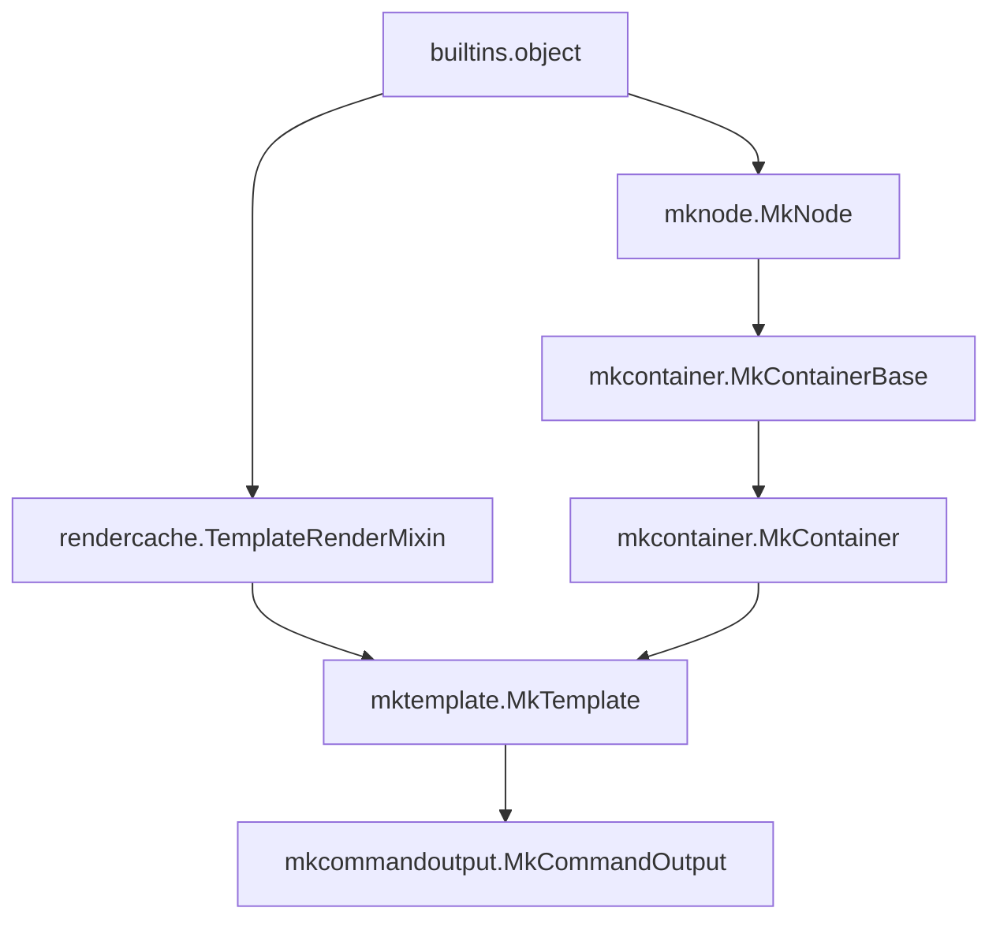

# MkCommandOutput

[ Show source on GitHub](https://github.com/phil65/mknodes/blob/main/src/mknodes/templatenodes/mkcommandoutput/__init__.py)

### Node to display the terminal output of a command.

<details open>
<summary>Examples</summary>

### Example: **Regular**
> [!NOTE]
> **Jinja**
>
> ```jinja
> {{ ["hatch", "--help"] | MkCommandOutput }}
>
> ```

> [!NOTE]
> **Python**
>
> ```python
> MkCommandOutput(['hatch', '--help'])
> ```

<details open>
<summary>Rendered</summary>

<div data-terminal>
  <span data-ty="input">hatch --help</span>
  <span data-ty>/bin/sh: 1: hatch: not found</span>
</div>

</details>

<details>
<summary>Markdown</summary>

```markdown
<div data-terminal>
  <span data-ty="input">hatch --help</span>
  <span data-ty>/bin/sh: 1: hatch: not found</span>
</div>
```

</details>

<details>
<summary>Html</summary>

```html
<div data-terminal>
  <span data-ty="input">hatch --help</span>
  <span data-ty>/bin/sh: 1: hatch: not found</span>
</div>

```

</details>

</details>

<details open>
<summary>DocStrings</summary>

<a id="mknodes.MkCommandOutput"></a>

```python
class MkCommandOutput(mktemplate.MkTemplate)
```

</details>

<details open>
<summary>Base classes</summary>

| Name | Children | Inherits |
|--- | --- | --- |
| **<font size='4'>[MkTemplate](https://phil65.github.io/mknodes/)</font>**<br>*<font size='1'>mknodes.templatenodes.mktemplate</font>*<br>Node representing a jinja template\. | <ul><li>[MkCliDoc](https://phil65.github.io/mknodes/)</li><li>[MkMaterialBadge](https://phil65.github.io/mknodes/)</li><li>[MkImageCompare](https://phil65.github.io/mknodes/)</li><li>[MkImageSlideshow](https://phil65.github.io/mknodes/)</li><li>[MkIFrame](https://phil65.github.io/mknodes/)</li><li>[MkCard](https://phil65.github.io/mknodes/)</li><li>[MkInstallGuide](https://phil65.github.io/mknodes/)</li><li>[MkCodeOfConduct](https://phil65.github.io/mknodes/)</li><li>[MkCommitConventions](https://phil65.github.io/mknodes/)</li><li>[MkDevEnvSetup](https://phil65.github.io/mknodes/)</li><li>[MkDevTools](https://phil65.github.io/mknodes/)</li><li>...</li></ul> | <ul><li>[TemplateRenderMixin](https://phil65.github.io/mknodes/)</li><li>[MkContainer](https://phil65.github.io/mknodes/)</li></ul> |

</details>

<details>
<summary>⋔ Inheritance diagram</summary>



</details>

<details>
<summary>NodeFile</summary>

**/home/runner/work/mknodes/mknodes/src/mknodes/templatenodes/mkcommandoutput/metadata.toml**

```toml
[metadata]
icon = "mdi:bash"
name = "MkCommandOutput"

[[resources.css]]
filename = "terminal.css"

[examples.regular]
condition = "{{ 'CI' | getenv }}"
title = "Regular"
jinja = """
{{ ["hatch", "--help"] | MkCommandOutput }}
"""

[output.html]
template = """
<div data-terminal>
  <span data-ty="input">{{ node.call | join(" ") }}</span>
  <span data-ty>{{ node.output }}</span>
</div>
"""

```

</details>

<details>
<summary>Code</summary>

**mknodes.templatenodes.mkcommandoutput.MkCommandOutput**

```python
class MkCommandOutput(mktemplate.MkTemplate):
    """Node to display the terminal output of a command."""

    ICON = "material/bash"
    STATUS = "new"
    CSS = [resources.CSSFile("terminal.css")]

    def __init__(self, call: Sequence[str], **kwargs: Any) -> None:
        """Constructor.

        Args:
            call: System call to make
            kwargs: Keyword arguments passed to parent
        """
        self.call = call
        super().__init__("output/html/template", **kwargs)

    @property
    def cwd(self):
        return self.ctx.metadata.repository_path

    def _command_params(self) -> dict[str, Any]:
        cwd = self.cwd
        return dict(call=" ".join(self.call), cwd=str(cwd) if cwd else None)

    def get_input_requests(self) -> list[inputs.InputRequest]:
        return [inputs.InputRequest.create("command", **self._command_params())]

    @property
    def output(self) -> str | None:
        """Output of the command (run in the resolve phase, inputs store kind `command`)."""
        return self.ctx.inputs.get("command", **self._command_params())

```

</details>

<details>
<summary>Page info</summary>

<details>
<summary>Code for this page</summary>

**mknodes.manual.nodes_section.create_section_for_nodes**

```python
def create_section_for_nodes(
    nav: mk.MkNav,
    klasses: Sequence[type[mk.MkNode]],
) -> mk.MkTable:
    table = mk.MkTable(columns=["Node", "Docstrings", "Markdown extensions"])
    for kls in klasses:
        tpl = "classpage_custom.jinja"
        page = mk.MkClassPage(kls, icon=kls.ICON, template_path=tpl, parent=nav, hide="toc")
        nav += page
        if kls.STATUS:
            page.metadata.status = kls.STATUS
        elif kls.JS_FILES:
            page.metadata.status = "js"
        elif kls.CSS:
            page.metadata.status = "css"
        page.created_by = create_section_for_nodes
        link = mk.MkLink(page, kls.__name__, icon=kls.ICON)
        extensions = ", ".join(f"`{i}`" for i in kls.REQUIRED_EXTENSIONS)
        table.add_row((link, kls.__doc__, extensions))
    return table

```

</details>

<details>
<summary>Resources</summary>

```python
Resources(css=[],
          markdown_extensions={'admonition': {},
                               'pymdownx.details': {},
                               'pymdownx.highlight': {'anchor_linenums': True,
                                                      'line_spans': '__span',
                                                      'pygments_lang_class': True},
                               'pymdownx.superfences': {'custom_fences': [{'class': 'mermaid',
                                                                           'format': <function fence_code_format at 0x7bb797a5c1a0>,
                                                                           'name': 'mermaid'}]},
                               'pymdownx.tabbed': {},
                               'tables': {}},
          plugins=[Plugin('mkdocstrings')],
          js=[],
          assets=[],
          packages=[])
```

</details>

<details>
<summary>Metadata</summary>

```yaml
created:
  source_filename: /home/runner/work/mknodes/mknodes/src/mknodes/manual/nodes_section.py
  source_function: create_section_for_nodes
  source_line_no: 93
hide:
- toc
icon: material/bash
status: new
title: MkCommandOutput

```

</details>

</details>
