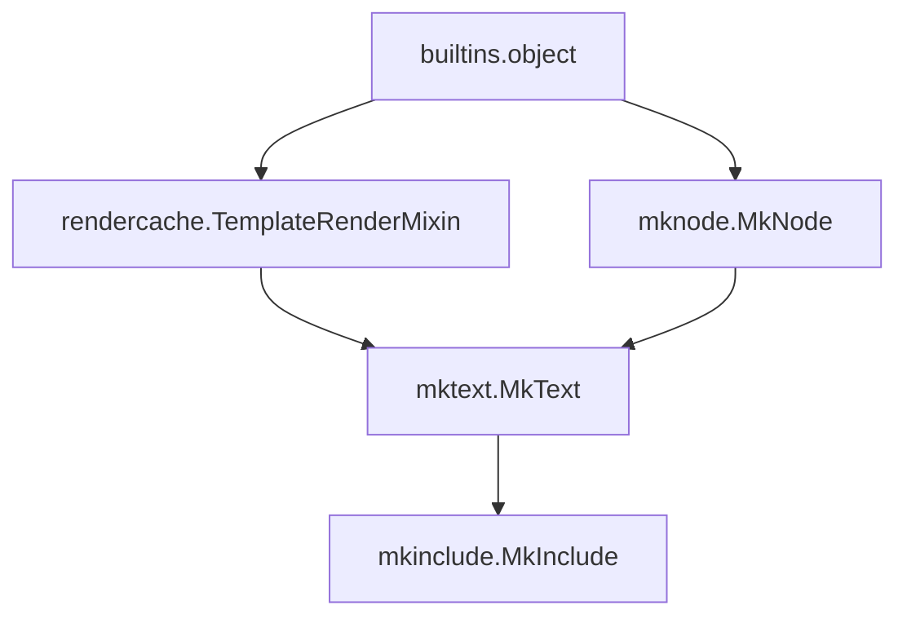

# MkInclude

[ Show source on GitHub](https://github.com/phil65/mknodes/blob/main/src/mknodes/templatenodes/mkinclude/__init__.py)

### Node to include the text of other Markdown files / MkNodes.

> [!NOTE]
> **Description**
>
>
> This node only keeps a reference to given target and resolves it when needed.
> Target can either be an URL or any other fsspec protocol path to a markdown file,
> a file system path to a markdown file, or another MkNode.

<details open>
<summary>Examples</summary>

### Example: **Include from URL**
> [!NOTE]
> **Jinja**
>
> ```jinja
> {{ "https://raw.githubusercontent.com/phil65/mknodes/main/README.md" | MkInclude }}
>
> ```

> [!NOTE]
> **Python**
>
> ```python
> MkInclude('https://raw.githubusercontent.com/phil65/mknodes/main/README.md')
> ```

<details open>
<summary>Rendered</summary>

# MkNodes

#### Don't write docs. Code them.

[](https://pypi.org/project/mknodes/)
[](https://pypi.org/project/mknodes/)
[](https://pypi.org/project/mknodes/)
[](https://pypi.org/project/mknodes/)
[](https://pypi.org/project/mknodes/)
[](https://pypi.org/project/mknodes/)
[](https://pypi.org/project/mknodes/)
[](https://pypi.org/project/mknodes/)
[](https://pypi.org/project/mknodes/)
[](https://github.com/phil65/mknodes/releases)
[](https://github.com/phil65/mknodes/graphs/contributors)
[](https://github.com/phil65/mknodes/discussions)
[](https://github.com/phil65/mknodes/forks)
[](https://github.com/phil65/mknodes/issues)
[](https://github.com/phil65/mknodes/pulls)
[](https://github.com/phil65/mknodes/watchers)
[](https://github.com/phil65/mknodes/stars)
[](https://github.com/phil65/mknodes)
[](https://github.com/phil65/mknodes/commits)
[](https://github.com/phil65/mknodes/releases)
[](https://github.com/phil65/mknodes)
[](https://github.com/phil65/mknodes)
[](https://github.com/phil65/mknodes)
[](https://github.com/phil65/mknodes)
[](https://codecov.io/gh/phil65/mknodes/)
[](https://pyup.io/repos/github/phil65/mknodes/)

[Read the completely coded documentation!](https://phil65.github.io/mknodes/)

The documentation is available in six variants:

| Variant | Engine / flavour |
| --- | --- |
| [Zensical](https://phil65.github.io/mknodes/) | `--engine zensical` (default), Material flavour |
| [MkDocs](https://phil65.github.io/mknodes/mkdocs/) | `--engine mkdocs`, Material for MkDocs |
| [mdBook](https://phil65.github.io/mknodes/mdbook/) | `--engine mdbook`, mdBook flavour |
| [Sphinx](https://phil65.github.io/mknodes/sphinx/) | `--engine sphinx`, MyST flavour (Furo theme) |
| [Docsify](https://phil65.github.io/mknodes/docsify/) | `--engine docsify`, GitHub flavour, rendered in the browser |
| [GitHub Markdown](https://github.com/phil65/mknodes/tree/docs-github) | `--engine markdown --flavor github`, rendered by GitHub itself |

They are all generated from the same build function (`mknodes.manual.root:Build.build`):
the node tree is written once and each engine gets the Markdown flavour it understands.

MkNodes lets you build documentation from Python objects instead of hand-written Markdown.
Pages, navigation sections and content blocks are *nodes* that render to
[Material for MkDocs](https://squidfunk.github.io/mkdocs-material/)-flavored Markdown and know
which Markdown extensions, CSS and JavaScript they need. Many nodes pull their content directly
from your project (pyproject.toml, git history, installed packages, docstrings), so the docs stay
in sync with the code.

## Installation

```bash
pip install mknodes
```

MkNodes includes a site generator (`mknodes build` / `serve` / `generate`) that builds
websites with [Zensical](https://zensical.org) (default), [MkDocs](https://www.mkdocs.org)
(`pip install mknodes[mkdocs]`), [mdBook](https://rust-lang.github.io/mdBook/) (the `mdbook`
binary), [Sphinx](https://www.sphinx-doc.org) with MyST (`pip install mknodes[sphinx]`) or
[Docsify](https://docsify.js.org) (no build step), or writes plain Markdown. MkDocs is not required. (The generator used to be the
separate `mkdocs-mknodes` package.)

## Quickstart

```py
import mknodes as mk

page = mk.MkPage("Overview")
page += mk.MkHeader("My project", level=1)
page += mk.MkAdmonition("Generated with MkNodes!", typ="tip", title="Note")
page += mk.MkTable({"Feature": ["Nodes", "Templating"], "Status": ["yes", "yes"]})
page += mk.MkCode("print('hello')", language="py")

print(page.to_markdown_sync())  # async code: `await page.to_markdown()`
print(page.to_markdown_sync(flavor="github"))  # GitHub flavour (READMEs)
```

## Features

- **75+ nodes**: admonitions, tabs, tables, code blocks, diagrams, cards, timelines, badges, ...
- **Project-aware nodes**: `MkChangelog`, `MkInstallGuide`, `MkDependencyTable`, `MkLicense`,
  `MkShields`, `MkClassDiagram`, ... build their content from your package and repository.
- **Navigation trees**: `MkNav` sections with decorator-based routing, API docs via `MkDoc`,
  CLI docs via `MkCliNav`, or parse an existing `SUMMARY.md` / folder.
- **Jinja templating**: every node is also a Jinja filter, e.g.
  `{{ "Inlined text" | MkAdmonition(inline="left") }}`.
- **Resource tracking**: required Markdown extensions, CSS and JS are collected per page.
- **Markdown extensions**: `/// mknodes` blocks and executable Python code blocks
  (`mknodes.mdext`).

### Build a website tree

```py
import mknodes as mk


def build(root: mk.MkNav, theme: mk.Theme) -> None:
    @root.route.page("Home", is_index=True)
    def _(page: mk.MkPage):
        page += mk.MkHeader("Welcome", level=1)
        page += mk.MkInstallGuide()

    @root.route.page("Changelog", icon="format-list-group")
    def _(page: mk.MkPage):
        page += mk.MkChangelog()
```

Configure it in `pyproject.toml` and build the website (run inside your project's repository):

```toml
[tool.mknodes]
build-fn = "mypackage.docs:build"
```

```bash
mknodes build                      # pages + mkdocs.generated.yml, then `zensical build`
mknodes serve                      # live preview
mknodes build --engine mkdocs      # same input, built with MkDocs + Material
mknodes build --engine mdbook      # book/ (book.toml, src/SUMMARY.md), then `mdbook build`
mknodes build --engine sphinx      # sphinx/ (conf.py, MyST pages, toctrees), then `sphinx-build`
mknodes build --engine docsify     # site/ (index.html, _sidebar.md, pages): no build step
mknodes generate --engine markdown --flavor github --generated-dir out  # plain Markdown
```

Each engine renders its own Markdown flavour (`material` for Zensical / MkDocs, `mdbook`,
`myst` for Sphinx, `github` for Docsify and plain Markdown): admonitions, tabs, code blocks and API docs degrade to what the
target understands. See [Site engines](https://phil65.github.io/mknodes/Site%20generator/site_engines/).

Without a build function, a default website gets generated (README, API docs, CLI docs,
development pages). Build functions are called as `build_fn(root=..., theme=..., **kwargs)`
(sync or async) and populate `root`.

The CLI also renders Jinja-enhanced Markdown: `mknodes render -i template.md -o output.md`
and `mknodes render-folder -i src_docs -o docs`.

### Markdown extensions

```py
import markdown

from mknodes.mdext.execute_ext import get_custom_fences

md = markdown.Markdown(
    extensions=["pymdownx.superfences", "mknodes.mdext"],
    extension_configs={"pymdownx.superfences": {"custom_fences": get_custom_fences()}},
)
```

````markdown
/// mknodes
{{ "Dynamic Header" | MkHeader(level=2) }}
///

```python exec="true"
print("**Generated at build time!**")
```
````

Use `session="name"` on `exec` blocks to share variables between them. See
[`src/mknodes/mdext/README.md`](https://github.com/phil65/mknodes/blob/main/src/mknodes/mdext/README.md) for all options.

## Documentation

The [documentation](https://phil65.github.io/mknodes/) is itself built with MkNodes
(see `src/mknodes/manual/`) and shows every node with examples.

</details>

<details>
<summary>Markdown</summary>

`````markdown
# MkNodes

#### Don't write docs. Code them.

[](https://pypi.org/project/mknodes/)
[](https://pypi.org/project/mknodes/)
[](https://pypi.org/project/mknodes/)
[](https://pypi.org/project/mknodes/)
[](https://pypi.org/project/mknodes/)
[](https://pypi.org/project/mknodes/)
[](https://pypi.org/project/mknodes/)
[](https://pypi.org/project/mknodes/)
[](https://pypi.org/project/mknodes/)
[](https://github.com/phil65/mknodes/releases)
[](https://github.com/phil65/mknodes/graphs/contributors)
[](https://github.com/phil65/mknodes/discussions)
[](https://github.com/phil65/mknodes/forks)
[](https://github.com/phil65/mknodes/issues)
[](https://github.com/phil65/mknodes/pulls)
[](https://github.com/phil65/mknodes/watchers)
[](https://github.com/phil65/mknodes/stars)
[](https://github.com/phil65/mknodes)
[](https://github.com/phil65/mknodes/commits)
[](https://github.com/phil65/mknodes/releases)
[](https://github.com/phil65/mknodes)
[](https://github.com/phil65/mknodes)
[](https://github.com/phil65/mknodes)
[](https://github.com/phil65/mknodes)
[](https://codecov.io/gh/phil65/mknodes/)
[](https://pyup.io/repos/github/phil65/mknodes/)

[Read the completely coded documentation!](https://phil65.github.io/mknodes/)

The documentation is available in six variants:

| Variant | Engine / flavour |
| --- | --- |
| [Zensical](https://phil65.github.io/mknodes/) | `--engine zensical` (default), Material flavour |
| [MkDocs](https://phil65.github.io/mknodes/mkdocs/) | `--engine mkdocs`, Material for MkDocs |
| [mdBook](https://phil65.github.io/mknodes/mdbook/) | `--engine mdbook`, mdBook flavour |
| [Sphinx](https://phil65.github.io/mknodes/sphinx/) | `--engine sphinx`, MyST flavour (Furo theme) |
| [Docsify](https://phil65.github.io/mknodes/docsify/) | `--engine docsify`, GitHub flavour, rendered in the browser |
| [GitHub Markdown](https://github.com/phil65/mknodes/tree/docs-github) | `--engine markdown --flavor github`, rendered by GitHub itself |

They are all generated from the same build function (`mknodes.manual.root:Build.build`):
the node tree is written once and each engine gets the Markdown flavour it understands.

MkNodes lets you build documentation from Python objects instead of hand-written Markdown.
Pages, navigation sections and content blocks are *nodes* that render to
[Material for MkDocs](https://squidfunk.github.io/mkdocs-material/)-flavored Markdown and know
which Markdown extensions, CSS and JavaScript they need. Many nodes pull their content directly
from your project (pyproject.toml, git history, installed packages, docstrings), so the docs stay
in sync with the code.

## Installation

```bash
pip install mknodes
```

MkNodes includes a site generator (`mknodes build` / `serve` / `generate`) that builds
websites with [Zensical](https://zensical.org) (default), [MkDocs](https://www.mkdocs.org)
(`pip install mknodes[mkdocs]`), [mdBook](https://rust-lang.github.io/mdBook/) (the `mdbook`
binary), [Sphinx](https://www.sphinx-doc.org) with MyST (`pip install mknodes[sphinx]`) or
[Docsify](https://docsify.js.org) (no build step), or writes plain Markdown. MkDocs is not required. (The generator used to be the
separate `mkdocs-mknodes` package.)

## Quickstart

```py
import mknodes as mk

page = mk.MkPage("Overview")
page += mk.MkHeader("My project", level=1)
page += mk.MkAdmonition("Generated with MkNodes!", typ="tip", title="Note")
page += mk.MkTable({"Feature": ["Nodes", "Templating"], "Status": ["yes", "yes"]})
page += mk.MkCode("print('hello')", language="py")

print(page.to_markdown_sync())  # async code: `await page.to_markdown()`
print(page.to_markdown_sync(flavor="github"))  # GitHub flavour (READMEs)
```

## Features

- **75+ nodes**: admonitions, tabs, tables, code blocks, diagrams, cards, timelines, badges, ...
- **Project-aware nodes**: `MkChangelog`, `MkInstallGuide`, `MkDependencyTable`, `MkLicense`,
  `MkShields`, `MkClassDiagram`, ... build their content from your package and repository.
- **Navigation trees**: `MkNav` sections with decorator-based routing, API docs via `MkDoc`,
  CLI docs via `MkCliNav`, or parse an existing `SUMMARY.md` / folder.
- **Jinja templating**: every node is also a Jinja filter, e.g.
  `{{ "Inlined text" | MkAdmonition(inline="left") }}`.
- **Resource tracking**: required Markdown extensions, CSS and JS are collected per page.
- **Markdown extensions**: `/// mknodes` blocks and executable Python code blocks
  (`mknodes.mdext`).

### Build a website tree

```py
import mknodes as mk


def build(root: mk.MkNav, theme: mk.Theme) -> None:
    @root.route.page("Home", is_index=True)
    def _(page: mk.MkPage):
        page += mk.MkHeader("Welcome", level=1)
        page += mk.MkInstallGuide()

    @root.route.page("Changelog", icon="format-list-group")
    def _(page: mk.MkPage):
        page += mk.MkChangelog()
```

Configure it in `pyproject.toml` and build the website (run inside your project's repository):

```toml
[tool.mknodes]
build-fn = "mypackage.docs:build"
```

```bash
mknodes build                      # pages + mkdocs.generated.yml, then `zensical build`
mknodes serve                      # live preview
mknodes build --engine mkdocs      # same input, built with MkDocs + Material
mknodes build --engine mdbook      # book/ (book.toml, src/SUMMARY.md), then `mdbook build`
mknodes build --engine sphinx      # sphinx/ (conf.py, MyST pages, toctrees), then `sphinx-build`
mknodes build --engine docsify     # site/ (index.html, _sidebar.md, pages): no build step
mknodes generate --engine markdown --flavor github --generated-dir out  # plain Markdown
```

Each engine renders its own Markdown flavour (`material` for Zensical / MkDocs, `mdbook`,
`myst` for Sphinx, `github` for Docsify and plain Markdown): admonitions, tabs, code blocks and API docs degrade to what the
target understands. See [Site engines](https://phil65.github.io/mknodes/Site%20generator/site_engines/).

Without a build function, a default website gets generated (README, API docs, CLI docs,
development pages). Build functions are called as `build_fn(root=..., theme=..., **kwargs)`
(sync or async) and populate `root`.

The CLI also renders Jinja-enhanced Markdown: `mknodes render -i template.md -o output.md`
and `mknodes render-folder -i src_docs -o docs`.

### Markdown extensions

```py
import markdown

from mknodes.mdext.execute_ext import get_custom_fences

md = markdown.Markdown(
    extensions=["pymdownx.superfences", "mknodes.mdext"],
    extension_configs={"pymdownx.superfences": {"custom_fences": get_custom_fences()}},
)
```

````markdown
/// mknodes
{{ "Dynamic Header" | MkHeader(level=2) }}
///

```python exec="true"
print("**Generated at build time!**")
```
````

Use `session="name"` on `exec` blocks to share variables between them. See
[`src/mknodes/mdext/README.md`](https://github.com/phil65/mknodes/blob/main/src/mknodes/mdext/README.md) for all options.

## Documentation

The [documentation](https://phil65.github.io/mknodes/) is itself built with MkNodes
(see `src/mknodes/manual/`) and shows every node with examples.

`````

</details>

<details>
<summary>Html</summary>

````html
<h1 id="mknodes">MkNodes<a href="#mknodes" aria-label="Link to heading 'MkNodes'" data-heading-content="MkNodes" class="anchor"></a></h1>
<h4 id="dont-write-docs-code-them">Don't write docs. Code them.<a href="#dont-write-docs-code-them" aria-label="Link to heading 'Don't write docs. Code them.'" data-heading-content="Don't write docs. Code them." class="anchor"></a></h4>
<p><a href="https://pypi.org/project/mknodes/"></a>
<a href="https://pypi.org/project/mknodes/"></a>
<a href="https://pypi.org/project/mknodes/"></a>
<a href="https://pypi.org/project/mknodes/"></a>
<a href="https://pypi.org/project/mknodes/"></a>
<a href="https://pypi.org/project/mknodes/"></a>
<a href="https://pypi.org/project/mknodes/"></a>
<a href="https://pypi.org/project/mknodes/"></a>
<a href="https://pypi.org/project/mknodes/"></a>
<a href="https://github.com/phil65/mknodes/releases"></a>
<a href="https://github.com/phil65/mknodes/graphs/contributors"></a>
<a href="https://github.com/phil65/mknodes/discussions"></a>
<a href="https://github.com/phil65/mknodes/forks"></a>
<a href="https://github.com/phil65/mknodes/issues"></a>
<a href="https://github.com/phil65/mknodes/pulls"></a>
<a href="https://github.com/phil65/mknodes/watchers"></a>
<a href="https://github.com/phil65/mknodes/stars"></a>
<a href="https://github.com/phil65/mknodes"></a>
<a href="https://github.com/phil65/mknodes/commits"></a>
<a href="https://github.com/phil65/mknodes/releases"></a>
<a href="https://github.com/phil65/mknodes"></a>
<a href="https://github.com/phil65/mknodes"></a>
<a href="https://github.com/phil65/mknodes"></a>
<a href="https://github.com/phil65/mknodes"></a>
<a href="https://codecov.io/gh/phil65/mknodes/"></a>
<a href="https://pyup.io/repos/github/phil65/mknodes/"></a></p>
<p><a href="https://phil65.github.io/mknodes/">Read the completely coded documentation!</a></p>
<p>The documentation is available in six variants:</p>
<table>
<thead>
<tr>
<th>Variant</th>
<th>Engine / flavour</th>
</tr>
</thead>
<tbody>
<tr>
<td><a href="https://phil65.github.io/mknodes/">Zensical</a></td>
<td><code>--engine zensical</code> (default), Material flavour</td>
</tr>
<tr>
<td><a href="https://phil65.github.io/mknodes/mkdocs/">MkDocs</a></td>
<td><code>--engine mkdocs</code>, Material for MkDocs</td>
</tr>
<tr>
<td><a href="https://phil65.github.io/mknodes/mdbook/">mdBook</a></td>
<td><code>--engine mdbook</code>, mdBook flavour</td>
</tr>
<tr>
<td><a href="https://phil65.github.io/mknodes/sphinx/">Sphinx</a></td>
<td><code>--engine sphinx</code>, MyST flavour (Furo theme)</td>
</tr>
<tr>
<td><a href="https://phil65.github.io/mknodes/docsify/">Docsify</a></td>
<td><code>--engine docsify</code>, GitHub flavour, rendered in the browser</td>
</tr>
<tr>
<td><a href="https://github.com/phil65/mknodes/tree/docs-github">GitHub Markdown</a></td>
<td><code>--engine markdown --flavor github</code>, rendered by GitHub itself</td>
</tr>
</tbody>
</table>
<p>They are all generated from the same build function (<code>mknodes.manual.root:Build.build</code>):
the node tree is written once and each engine gets the Markdown flavour it understands.</p>
<p>MkNodes lets you build documentation from Python objects instead of hand-written Markdown.
Pages, navigation sections and content blocks are <em>nodes</em> that render to
<a href="https://squidfunk.github.io/mkdocs-material/">Material for MkDocs</a>-flavored Markdown and know
which Markdown extensions, CSS and JavaScript they need. Many nodes pull their content directly
from your project (pyproject.toml, git history, installed packages, docstrings), so the docs stay
in sync with the code.</p>
<h2 id="installation">Installation<a href="#installation" aria-label="Link to heading 'Installation'" data-heading-content="Installation" class="anchor"></a></h2>
<pre><code class="language-bash">pip install mknodes
</code></pre>
<p>MkNodes includes a site generator (<code>mknodes build</code> / <code>serve</code> / <code>generate</code>) that builds
websites with <a href="https://zensical.org">Zensical</a> (default), <a href="https://www.mkdocs.org">MkDocs</a>
(<code>pip install mknodes[mkdocs]</code>), <a href="https://rust-lang.github.io/mdBook/">mdBook</a> (the <code>mdbook</code>
binary), <a href="https://www.sphinx-doc.org">Sphinx</a> with MyST (<code>pip install mknodes[sphinx]</code>) or
<a href="https://docsify.js.org">Docsify</a> (no build step), or writes plain Markdown. MkDocs is not required. (The generator used to be the
separate <code>mkdocs-mknodes</code> package.)</p>
<h2 id="quickstart">Quickstart<a href="#quickstart" aria-label="Link to heading 'Quickstart'" data-heading-content="Quickstart" class="anchor"></a></h2>
<pre><code class="language-py">import mknodes as mk

page = mk.MkPage(&quot;Overview&quot;)
page += mk.MkHeader(&quot;My project&quot;, level=1)
page += mk.MkAdmonition(&quot;Generated with MkNodes!&quot;, typ=&quot;tip&quot;, title=&quot;Note&quot;)
page += mk.MkTable({&quot;Feature&quot;: [&quot;Nodes&quot;, &quot;Templating&quot;], &quot;Status&quot;: [&quot;yes&quot;, &quot;yes&quot;]})
page += mk.MkCode(&quot;print('hello')&quot;, language=&quot;py&quot;)

print(page.to_markdown_sync())  # async code: `await page.to_markdown()`
print(page.to_markdown_sync(flavor=&quot;github&quot;))  # GitHub flavour (READMEs)
</code></pre>
<h2 id="features">Features<a href="#features" aria-label="Link to heading 'Features'" data-heading-content="Features" class="anchor"></a></h2>
<ul>
<li><strong>75+ nodes</strong>: admonitions, tabs, tables, code blocks, diagrams, cards, timelines, badges, ...</li>
<li><strong>Project-aware nodes</strong>: <code>MkChangelog</code>, <code>MkInstallGuide</code>, <code>MkDependencyTable</code>, <code>MkLicense</code>,
<code>MkShields</code>, <code>MkClassDiagram</code>, ... build their content from your package and repository.</li>
<li><strong>Navigation trees</strong>: <code>MkNav</code> sections with decorator-based routing, API docs via <code>MkDoc</code>,
CLI docs via <code>MkCliNav</code>, or parse an existing <code>SUMMARY.md</code> / folder.</li>
<li><strong>Jinja templating</strong>: every node is also a Jinja filter, e.g.
<code>{{ &quot;Inlined text&quot; | MkAdmonition(inline=&quot;left&quot;) }}</code>.</li>
<li><strong>Resource tracking</strong>: required Markdown extensions, CSS and JS are collected per page.</li>
<li><strong>Markdown extensions</strong>: <code>/// mknodes</code> blocks and executable Python code blocks
(<code>mknodes.mdext</code>).</li>
</ul>
<h3 id="build-a-website-tree">Build a website tree<a href="#build-a-website-tree" aria-label="Link to heading 'Build a website tree'" data-heading-content="Build a website tree" class="anchor"></a></h3>
<pre><code class="language-py">import mknodes as mk


def build(root: mk.MkNav, theme: mk.Theme) -&gt; None:
    @root.route.page(&quot;Home&quot;, is_index=True)
    def _(page: mk.MkPage):
        page += mk.MkHeader(&quot;Welcome&quot;, level=1)
        page += mk.MkInstallGuide()

    @root.route.page(&quot;Changelog&quot;, icon=&quot;format-list-group&quot;)
    def _(page: mk.MkPage):
        page += mk.MkChangelog()
</code></pre>
<p>Configure it in <code>pyproject.toml</code> and build the website (run inside your project's repository):</p>
<pre><code class="language-toml">[tool.mknodes]
build-fn = &quot;mypackage.docs:build&quot;
</code></pre>
<pre><code class="language-bash">mknodes build                      # pages + mkdocs.generated.yml, then `zensical build`
mknodes serve                      # live preview
mknodes build --engine mkdocs      # same input, built with MkDocs + Material
mknodes build --engine mdbook      # book/ (book.toml, src/SUMMARY.md), then `mdbook build`
mknodes build --engine sphinx      # sphinx/ (conf.py, MyST pages, toctrees), then `sphinx-build`
mknodes build --engine docsify     # site/ (index.html, _sidebar.md, pages): no build step
mknodes generate --engine markdown --flavor github --generated-dir out  # plain Markdown
</code></pre>
<p>Each engine renders its own Markdown flavour (<code>material</code> for Zensical / MkDocs, <code>mdbook</code>,
<code>myst</code> for Sphinx, <code>github</code> for Docsify and plain Markdown): admonitions, tabs, code blocks and API docs degrade to what the
target understands. See <a href="https://phil65.github.io/mknodes/Site%20generator/site_engines/">Site engines</a>.</p>
<p>Without a build function, a default website gets generated (README, API docs, CLI docs,
development pages). Build functions are called as <code>build_fn(root=..., theme=..., **kwargs)</code>
(sync or async) and populate <code>root</code>.</p>
<p>The CLI also renders Jinja-enhanced Markdown: <code>mknodes render -i template.md -o output.md</code>
and <code>mknodes render-folder -i src_docs -o docs</code>.</p>
<h3 id="markdown-extensions">Markdown extensions<a href="#markdown-extensions" aria-label="Link to heading 'Markdown extensions'" data-heading-content="Markdown extensions" class="anchor"></a></h3>
<pre><code class="language-py">import markdown

from mknodes.mdext.execute_ext import get_custom_fences

md = markdown.Markdown(
    extensions=[&quot;pymdownx.superfences&quot;, &quot;mknodes.mdext&quot;],
    extension_configs={&quot;pymdownx.superfences&quot;: {&quot;custom_fences&quot;: get_custom_fences()}},
)
</code></pre>
<pre><code class="language-markdown">/// mknodes
{{ &quot;Dynamic Header&quot; | MkHeader(level=2) }}
///

```python exec=&quot;true&quot;
print(&quot;**Generated at build time!**&quot;)
```
</code></pre>
<p>Use <code>session=&quot;name&quot;</code> on <code>exec</code> blocks to share variables between them. See
<a href="https://github.com/phil65/mknodes/blob/main/src/mknodes/mdext/README.md"><code>src/mknodes/mdext/README.md</code></a> for all options.</p>
<h2 id="documentation">Documentation<a href="#documentation" aria-label="Link to heading 'Documentation'" data-heading-content="Documentation" class="anchor"></a></h2>
<p>The <a href="https://phil65.github.io/mknodes/">documentation</a> is itself built with MkNodes
(see <code>src/mknodes/manual/</code>) and shows every node with examples.</p>

````

</details>

</details>

<details open>
<summary>DocStrings</summary>

<a id="mknodes.MkInclude"></a>

```python
class MkInclude(mktext.MkText)
```

</details>

<details open>
<summary>Base classes</summary>

| Name | Children | Inherits |
|--- | --- | --- |
| **<font size='4'>[MkText](https://phil65.github.io/mknodes/)</font>**<br>*<font size='1'>mknodes.basenodes.mktext</font>*<br>Class for any Markup text\. | <ul><li>[MkInclude](https://phil65.github.io/mknodes/)</li><li>[MkChangelog](https://phil65.github.io/mknodes/)</li><li>[MkLicense](https://phil65.github.io/mknodes/)</li><li>[MkLlm](https://phil65.github.io/mknodes/)</li></ul> | <ul><li>[TemplateRenderMixin](https://phil65.github.io/mknodes/)</li><li>[MkNode](https://phil65.github.io/mknodes/)</li></ul> |

</details>

<details>
<summary>⋔ Inheritance diagram</summary>



</details>

<details>
<summary>NodeFile</summary>

**/home/runner/work/mknodes/mknodes/src/mknodes/templatenodes/mkinclude/metadata.toml**

```toml
[metadata]
name = "MkInclude"
icon = "octicon:file-symlink-file-24"

[examples.url]
title = "Include from URL"
jinja = """
{{ "https://raw.githubusercontent.com/phil65/mknodes/main/README.md" | MkInclude }}
"""

[output.markdown]
template = """
{{ node.get_text() }}
"""

```

</details>

<details>
<summary>Code</summary>

**mknodes.templatenodes.mkinclude.MkInclude**

```python
class MkInclude(mktext.MkText):
    """Node to include the text of other Markdown files / MkNodes.

    This node only keeps a reference to given target and resolves it when needed.
    Target can either be an URL or any other fsspec protocol path to a markdown file,
    a file system path to a markdown file, or another MkNode.
    """

    ICON = "octicons/file-symlink-file-24"

    def __init__(self, target: str | os.PathLike[str] | mktext.MkText, **kwargs: Any) -> None:
        """Constructor.

        Args:
            target: target to include
            kwargs: Keyword arguments passed to parent
        """
        super().__init__(**kwargs)
        self.target = target

    def _remote_url(self) -> str | None:
        """Return the target if it is a remote URL (pinned in the lock file)."""
        if isinstance(self.target, str) and pathhelpers.is_remote(self.target):
            return self.target
        return None

    def get_input_requests(self) -> list[inputs.InputRequest]:
        if url := self._remote_url():
            return [inputs.InputRequest.create("file", url=url)]
        return []

    def get_text(self) -> str:
        if url := self._remote_url():
            return self.ctx.inputs.get("file", url=url)
        match self.target:
            case os.PathLike() | str():
                return pathhelpers.load_file_cached(os.fspath(self.target))
            case mktext.MkText():
                return str(self.target)
            case _:
                raise TypeError(self.target)

```

</details>

<details>
<summary>Page info</summary>

<details>
<summary>Code for this page</summary>

**mknodes.manual.nodes_section.create_section_for_nodes**

```python
def create_section_for_nodes(
    nav: mk.MkNav,
    klasses: Sequence[type[mk.MkNode]],
) -> mk.MkTable:
    table = mk.MkTable(columns=["Node", "Docstrings", "Markdown extensions"])
    for kls in klasses:
        tpl = "classpage_custom.jinja"
        page = mk.MkClassPage(kls, icon=kls.ICON, template_path=tpl, parent=nav, hide="toc")
        nav += page
        if kls.STATUS:
            page.metadata.status = kls.STATUS
        elif kls.JS_FILES:
            page.metadata.status = "js"
        elif kls.CSS:
            page.metadata.status = "css"
        page.created_by = create_section_for_nodes
        link = mk.MkLink(page, kls.__name__, icon=kls.ICON)
        extensions = ", ".join(f"`{i}`" for i in kls.REQUIRED_EXTENSIONS)
        table.add_row((link, kls.__doc__, extensions))
    return table

```

</details>

<details>
<summary>Resources</summary>

```python
Resources(css=[],
          markdown_extensions={'admonition': {},
                               'pymdownx.details': {},
                               'pymdownx.highlight': {'anchor_linenums': True,
                                                      'line_spans': '__span',
                                                      'pygments_lang_class': True},
                               'pymdownx.superfences': {'custom_fences': [{'class': 'mermaid',
                                                                           'format': <function fence_code_format at 0x7bb797a5c1a0>,
                                                                           'name': 'mermaid'}]},
                               'pymdownx.tabbed': {},
                               'tables': {}},
          plugins=[Plugin('mkdocstrings')],
          js=[],
          assets=[],
          packages=[])
```

</details>

<details>
<summary>Metadata</summary>

```yaml
created:
  source_filename: /home/runner/work/mknodes/mknodes/src/mknodes/manual/nodes_section.py
  source_function: create_section_for_nodes
  source_line_no: 93
hide:
- toc
icon: octicons/file-symlink-file-24
title: MkInclude

```

</details>

</details>
