# The nodes

Basically everything interesting in this library inherits from MkNode.
It`s the base class for all tree nodes we are building. The tree goes from the root nav
down to single markup elements. We can show the subclass tree by using
the MkClassDiagram Node.

## All the nodes

```mermaid
graph LR
  1359323199["mknode.MkNode"]
  1956333208["mkcontainer.MkContainerBase"]
  835538629["mkcontainer.MkContainer"]
  1483073837["mkblock.MkBlock"]
  178616935["mkadmonition.MkAdmonition"]
  1647548858["mkblockquote.MkBlockQuote"]
  1761293797["mkcode.MkCode"]
  1289759389["mktemplate.MkTemplate"]
  3178260457["mklist.MkList"]
  3678415322["mkbasetable.MkBaseTable"]
  2293543343["mktabs.MkTab"]
  3468216723["mktabcontainer.MkTabContainer"]
  832683224["mkcritic.MkCritic"]
  596592930["mkannotations.MkAnnotation"]
  3461153190["mkannotations.MkAnnotations"]
  605012372["mkfootnotes.MkFootNote"]
  3964180375["mkfootnotes.MkFootNotes"]
  2133900327["mkdefinitionlist.MkDefinition"]
  178757003["mkdefinitionlist.MkDefinitionList"]
  1511245065["mkpage.MkPage"]
  2297657893["mkshowcase.MkShowcase"]
  1965962441["mkspeechbubble.MkSpeechBubble"]
  2629609700["mktasklist.MkTask"]
  3678778186["mktasklist.MkTaskList"]
  1587059980["mktimeline.MkTimeline"]
  2259144671["mkshields.MkShields"]
  4160346072["mkmetadatabadges.MkMetadataBadges"]
  967125406["mkcompactadmonition.MkCompactAdmonition"]
  922779809["mklink.MkLink"]
  1315922923["mktext.MkText"]
  2309987051["mkinclude.MkInclude"]
  3675748703["mkchangelog.MkChangelog"]
  572912842["mklicense.MkLicense"]
  4031386596["mkllm.MkLlm"]
  3755447610["mkheader.MkHeader"]
  3789204887["mkkeys.MkKeys"]
  2323526077["_mkdocstrings.MkDocStrings"]
  1574311463["mkicon.MkIcon"]
  4050704754["mkimage.MkImage"]
  1150703457["mkbinaryimage.MkBinaryImage"]
  3610159806["mkbadge.MkBadge"]
  492688635["mkprogressbar.MkProgressBar"]
  1775024518["templateblocks.BaseBlock"]
  3629627916["templateblocks.HtmlBlock"]
  1251422456["templateblocks.Block"]
  1578298897["templateblocks.AnalyticsBlock"]
  3028490842["templateblocks.SiteMetaBlock"]
  435726771["templateblocks.ExtraHeadBlock"]
  3050035941["templateblocks.TitleBlock"]
  2868209474["templateblocks.BaseJSBlock"]
  1724714845["templateblocks.LibsBlock"]
  713806774["templateblocks.ScriptsBlock"]
  2956126995["templateblocks.StylesBlock"]
  897540826["mktimeline.MkTimelineItem"]
  2560524204["mkpyodide.MkPyodideTerminal"]
  282531588["mkjupyterlite.MkJupyterLite"]
  2959701746["mkpyscript.MkPyScript"]
  3545478837["mkdataclassinfo.MkDataClassInfo"]
  2476956614["mknav.MkNav"]
  3626515632["mkdoc.MkDoc"]
  4145724419["mkclinav.MkCliNav"]
  814948336["defaultsite.MkDefaultWebsite"]
  1225063181["mktemplatetable.MkTemplateTable"]
  2369531301["mkclasstable.MkClassTable"]
  753441108["mkdependencytable.MkDependencyTable"]
  1810812730["mkmoduletable.MkModuleTable"]
  3369307935["mkpydeps.MkPyDeps"]
  1937074085["flavors.FlavorComparison"]
  1359323199 --> 1956333208
  1956333208 --> 835538629
  835538629 --> 1483073837
  835538629 --> 178616935
  835538629 --> 1647548858
  835538629 --> 1761293797
  835538629 --> 1289759389
  835538629 --> 3178260457
  835538629 --> 3678415322
  835538629 --> 2293543343
  835538629 --> 3468216723
  835538629 --> 832683224
  835538629 --> 596592930
  835538629 --> 3461153190
  835538629 --> 605012372
  835538629 --> 3964180375
  835538629 --> 2133900327
  835538629 --> 178757003
  835538629 --> 1511245065
  835538629 --> 2297657893
  835538629 --> 1965962441
  835538629 --> 2629609700
  835538629 --> 3678778186
  835538629 --> 1587059980
  835538629 --> 2259144671
  835538629 --> 4160346072
  1359323199 --> 967125406
  1359323199 --> 922779809
  1359323199 --> 1315922923
  1315922923 --> 2309987051
  1315922923 --> 3675748703
  1315922923 --> 572912842
  1315922923 --> 4031386596
  1359323199 --> 3755447610
  1359323199 --> 3789204887
  1359323199 --> 2323526077
  1359323199 --> 1574311463
  1359323199 --> 4050704754
  4050704754 --> 1150703457
  4050704754 --> 3610159806
  1359323199 --> 492688635
  1359323199 --> 1775024518
  1775024518 --> 3629627916
  1775024518 --> 1251422456
  1251422456 --> 1578298897
  1251422456 --> 3028490842
  1251422456 --> 435726771
  1775024518 --> 3050035941
  1775024518 --> 2868209474
  2868209474 --> 1724714845
  2868209474 --> 713806774
  1775024518 --> 2956126995
  1359323199 --> 897540826
  1359323199 --> 2560524204
  1359323199 --> 282531588
  1359323199 --> 2959701746
  1359323199 --> 3545478837
  1359323199 --> 2476956614
  2476956614 --> 3626515632
  2476956614 --> 4145724419
  2476956614 --> 814948336
  1359323199 --> 1225063181
  1225063181 --> 2369531301
  1225063181 --> 753441108
  1225063181 --> 1810812730
  1359323199 --> 3369307935
  1359323199 --> 1937074085
```



<details>
<summary>Page info</summary>

<details>
<summary>Code for this section</summary>

**mknodes.manual.nodes_section._**

```python
@nav.route.page(is_index=True)
def _(page: mk.MkPage) -> None:
    page += mk.MkTemplate("nodes_index.jinja")

```

</details>

<details>
<summary>Resources</summary>

```python
Resources(css=[],
          markdown_extensions={'pymdownx.superfences': {'custom_fences': [{'class': 'mermaid',
                                                                           'format': <function fence_code_format at 0x7bb797a5c1a0>,
                                                                           'name': 'mermaid'}]}},
          plugins=[],
          js=[],
          assets=[],
          packages=[])
```

</details>

<details>
<summary>Metadata</summary>

```yaml
created:
  source_filename: /home/runner/work/mknodes/mknodes/src/mknodes/manual/nodes_section.py
  source_function: _
  source_line_no: 118
title: The nodes

```

</details>

</details>
